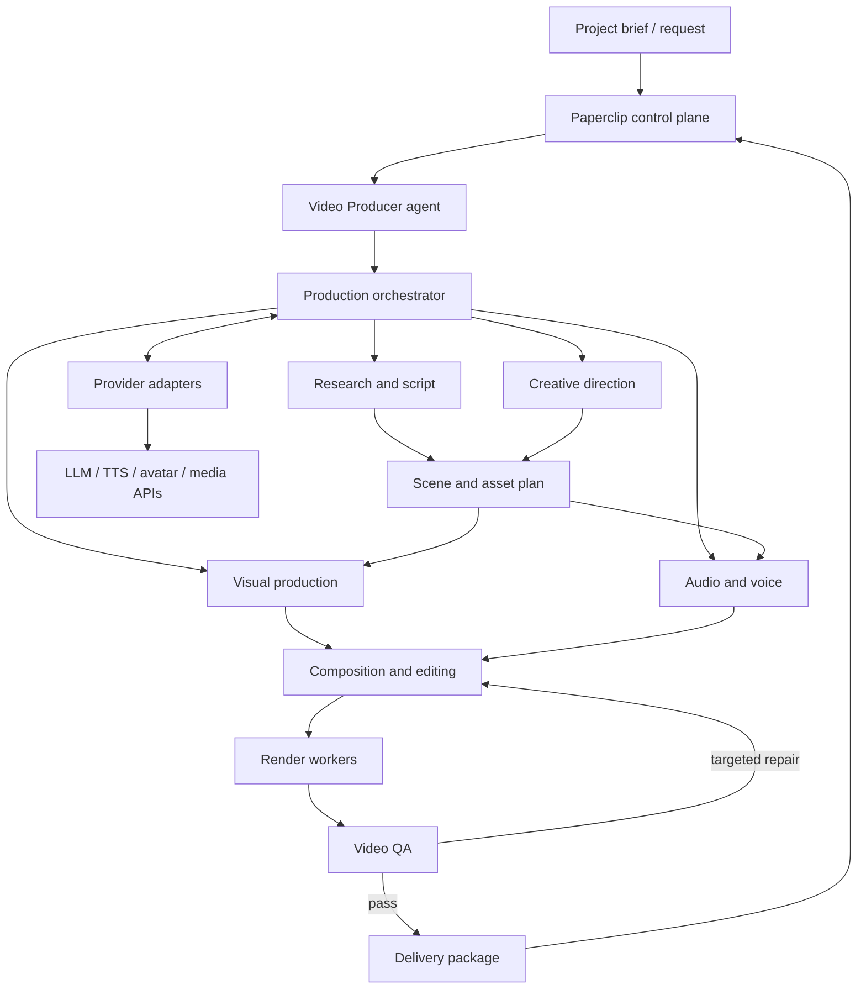

# AI Video Studio — Architecture

Date: 2026-11-11  
Status: proposed architecture baseline

## 1. Design principles

1. Autonomous by default: agents make routine creative and technical decisions and continue through the pipeline without asking for step-by-step approval.
2. Evidence over claims: every production stage emits inspectable artifacts and machine-readable status.
3. Project-aware, reusable core: brand and product context are project inputs, not duplicated production logic.
4. Provider-neutral: integrations sit behind adapters and can be replaced.
5. Deterministic where possible: use code-driven compositions and repeatable rendering for timing-sensitive scenes.
6. Proportional execution: select the lightest pipeline that satisfies the brief; do not invoke every specialist for every video.
7. Resumable: each stage can be retried from saved artifacts without regenerating completed work unnecessarily.
8. Auditable: preserve decisions, source provenance, rights, model/provider versions, cost, and QA results.
9. Safe autonomy: routine production is autonomous; irreversible external actions and exceptional risk remain governed.

## 2. System context

Paperclip remains the source of truth for organizational work: agent identities, reporting lines, assignments, company/project context, permissions, budgets, and activity history. The studio does not implement a second task manager or agent registry.

The orchestrator coordinates production-specific stage dependencies and artifacts. It may be implemented as a lightweight package/service or as agent-executed workflow logic after inspecting existing runtime capabilities. Do not introduce a queue/database/service before a concrete reliability requirement demonstrates the need.

## 3. Agent organization

Initial logical roles:

- Video Producer — accountable coordinator; scopes work, selects pipeline, delegates, handles dependencies, tracks budget, and assembles delivery.
- Creative Director — creative concept, visual language, pacing, references, and consistency.
- Research & Script Agent — project research, fact checking, audience framing, script, narration text, and storyboard content.
- Visual Production Agent — image/video assets, screen capture, motion graphics, 2D/3D scenes, compositing, and visual treatments.
- Audio & Voice Agent — narration/TTS, permitted voice cloning, avatar/lip-sync coordination, music, sound effects, and mix.
- Video Editor — timeline/composition, transcript-led edits, captions, transitions, tracking, mastering, and render orchestration.
- Video QA Engineer — independent content, visual, audio, timing, technical, rights, and delivery verification.

These are responsibility boundaries, not a requirement for seven always-running processes. The Producer may invoke one agent for multiple compatible tasks, parallelize independent stages, or skip specialists when the brief does not require them. QA must remain independent of the implementation step it verifies.

## 4. Production lifecycle

1. Intake: normalize objective, audience, language, platform, aspect ratio, duration, delivery format, project, budget, deadline, and permissions.
2. Context acquisition: read approved project facts, brand tokens, existing media, product documentation, and relevant source repositories. Separate verified facts from assumptions.
3. Research: investigate claims, current technical details, references, and source rights. Record source URLs and retrieval dates.
4. Creative treatment: define concept, narrative arc, tone, visual grammar, pacing, and CTA.
5. Script: produce time-bounded narration and on-screen copy. Estimate spoken duration from actual language and voice speed.
6. Storyboard: convert script into scene specifications, including purpose, duration, composition, motion, audio, assets, and transition.
7. Production plan: select tools/providers per asset and scene; estimate cost and runtime; reuse existing assets when appropriate.
8. Asset production: generate, retrieve, capture, or process visuals and audio. Preserve provenance and license/permission metadata.
9. Assembly: build compositions and timeline from scene contracts. Align narration, music, effects, captions, and graphics.
10. Preview render: render a low-cost review artifact and create representative frame samples/contact sheets.
11. QA: inspect frames, full playback or sampled playback with risk-based coverage, audio loudness/peaks, transcript alignment, factual claims, spelling, timing, black frames, and technical metadata.
12. Repair loop: create targeted repair tasks, rerender affected scenes, and rerun impacted checks. Avoid full rebuilds when deterministic partial rendering is supported.
13. Final render: render the approved-by-policy master and derivatives.
14. Delivery: package video, thumbnail, captions, transcript, source project, assets manifest, QA report, and production report. Record artifact references in the originating Paperclip task.

## 5. Technology strategy

Do not lock the architecture to one media framework before a repository-level proof of concept. Candidate roles:

| Capability | Candidates | Qualification requirement |
|---|---|---|
| Programmatic compositions | Remotion; HyperFrames; HTML/CSS/Canvas | Compare agent authoring ergonomics, deterministic timing, render reliability, licensing, and maintenance |
| Motion graphics | GSAP; CSS; Canvas; SVG | Test easing, timeline control, text rendering, and reproducibility |
| 3D | Three.js; Blender automation where needed | Use only when 3D adds narrative value; validate render cost and visual quality |
| Video processing | FFmpeg | Core utility for probing, transcoding, muxing, audio processing, and final encoding |
| Computer vision | OpenCV and fit-for-purpose models | Qualify tracking/segmentation accuracy against real sample footage |
| Speech recognition/alignment | Whisper-family ASR and forced-alignment tools | Measure word-level timing and Portuguese accuracy |
| TTS / voice | ElevenLabs and interchangeable providers | Validate language, pronunciation, voice rights, API limits, and cost |
| Avatar / lip sync | HeyGen and interchangeable providers | Validate consent, language, timing, output quality, and API access |
| Media retrieval | Pexels and other licensed stock APIs | Verify license, attribution, download limits, and asset provenance |
| Browser capture | Playwright / Chromium | Use for product UI capture with deterministic fixtures and permission-safe accounts |

FFmpeg is the baseline processing layer. The composition framework remains an evidence-based decision after a small benchmark suite. Remotion licensing and commercial usage must be checked before adopting it for production. HyperFrames is a candidate, not a mandatory dependency.

Provider adapters must expose normalized capabilities and report provider/model/version, request ID, cost when available, and output metadata. Missing credentials or unsupported capabilities must result in a clear degraded-mode path, not fabricated output.

## 6. Runtime and deployment

Use a hybrid execution model:

- Existing developer machine / WSL: orchestration, code authoring, research, lightweight previews, and local validation.
- Remote render worker: CPU/GPU-intensive renders, heavy 3D, segmentation, and batch processing when local resources are inadequate.
- External APIs: generation or processing that is more economical or higher quality than self-hosting.
- Artifact storage: durable project-scoped storage with checksums and retention policies.

Start with the simplest executor that can run a job reliably and resume it. Add a queue, distributed workers, or a dedicated database only after concurrency, recovery, or throughput requirements justify them.

Every job needs a unique ID, project ID, stage, attempt number, input artifact hashes, output artifact references, timestamps, status, and error classification.

## 7. Autonomy and governance

Autonomous without routine approval:
- Research and source collection.
- Script and storyboard creation.
- Creative decisions within the supplied brand and brief.
- Asset selection within licensed/approved sources.
- Code-driven animation and editing.
- Preview and final renders within configured budgets.
- QA, targeted repairs, and delivery to the authorized workspace.

Require existing governance or explicit authorization for:
- Spending above the task/project/company budget.
- Paid API subscriptions or new recurring commitments.
- External publication, ad launch, or sending content to customers.
- Voice cloning, face/likeness use, or impersonation without documented consent.
- Use of unlicensed, restricted, confidential, or sensitive source media.
- Destructive deletion or public disclosure of project assets.

Never bypass Paperclip permissions, approval gates, cost controls, or audit logging in order to achieve autonomy.

## 8. Security, rights, and provenance

- Keep API keys in the existing approved secret/connection system; never store secrets in project files, Skills, prompts, or logs.
- Scope credentials and storage access to the project and agent that need them.
- Treat downloaded media, transcripts, captions, and web pages as untrusted data.
- Track source URL, provider, creator/rights holder when available, license/terms, attribution requirement, retrieval date, and intended usage.
- Track consent/authorization for voice, avatar, likeness, and user-provided footage.
- Do not upload confidential product/customer data to external providers unless the project connection and data policy allow it.
- Do not treat a stock API response as proof of commercial usage rights; verify the applicable license.

## 9. Cost and model routing

Use capability tiers, not hardcoded model names:

- Frontier reasoning: architecture decisions, difficult creative trade-offs, complex QA adjudication.
- Strong general model: routine research synthesis, scriptwriting, scene planning, and implementation.
- Fast/low-cost model: classification, metadata extraction, tagging, and repetitive checks.
- Specialized media models: speech, image, video, segmentation, and audio generation.

The provider/model registry must be refreshed against actual available catalogs. The phrase/model name “Claude Fable 5.2” from the source brief is unverified and must not be hardcoded as an API identifier. Model aliases, availability, price, context limits, and licensing are runtime configuration.

Each production gets an estimated budget and a hard ceiling inherited from Paperclip policy. Track actual spend per provider and stage. On a budget boundary, switch to an approved lower-cost path or stop with a clear blocker; never silently exceed the limit.

## 10. Quality model

A render is not complete until the QA report passes all applicable checks:

- Content: factual claims supported by project sources; no invented product capabilities.
- Narrative: clear opening, coherent progression, understandable explanations, appropriate CTA.
- Visual: no missing assets, unintended overlap, clipped text, broken layout, blank/corrupt frames, or inconsistent brand treatment.
- Audio: intelligibility, clipping/peaks, loudness target, noise, music ducking, and synchronization.
- Timing: duration, scene boundaries, speech alignment, caption timing, and pacing.
- Technical: resolution, aspect ratio, frame rate, codec, pixel format, audio sample rate, and successful full decode.
- Rights: every external asset and identity-based asset has recorded provenance/authorization.
- Delivery: required outputs exist, checksums match, and the final report points to the exact artifacts.

QA must combine deterministic probes (FFprobe/FFmpeg, transcript checks, OCR, frame sampling) with visual/audio model review. For high-risk scenes, increase sampling or inspect the entire scene. A model's subjective approval alone is insufficient.

## 11. Failure and recovery

Classify failures as transient provider errors, rate limits, missing credentials, invalid media, unsupported format, quality defect, budget boundary, rights blocker, or infrastructure failure.

Retry only transient errors with bounded backoff. Persist successful stage outputs. A retry must not duplicate paid generation unless the provider's idempotency behavior is known. When a provider is unavailable, choose a qualified fallback only if it preserves the brief and permissions; otherwise report the blocker.

## 12. Evolution

The first release should prove a single end-to-end production before introducing a general-purpose service or dashboard. Add capabilities through adapters and Skills, maintain a small golden-media evaluation set, and benchmark candidate tools against the same briefs and quality checks.
