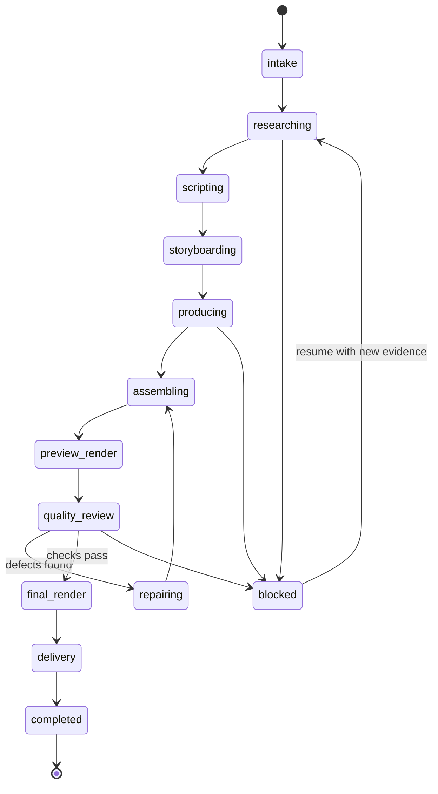

# AI Video Studio — Production Contracts

Date: 2026-11-11  
Status: initial contract; schemas to be implemented after runtime qualification

These contracts define the minimum data that must move between production stages. They are intentionally implementation-neutral. JSON Schema or TypeScript validators should be added only after the existing monorepo conventions and package boundaries are inspected.

## 1. Project manifest

Every production has a project manifest containing:

- `schemaVersion`
- `productionId` and originating Paperclip task/work-product reference
- `projectKey` and project display name
- `brief`: objective, audience, language, platform, CTA, duration target, aspect ratio, resolution, frame rate
- `brandProfileRef`: approved logo, colors, fonts, tone, safe-area rules, and asset references
- `permissions`: approved provider use, media rights, voice/avatar consent, publication authority
- `budget`: currency, estimate, hard ceiling, and actual spend
- `status`, timestamps, and current stage

Do not copy secrets or raw provider credentials into the manifest.

## 2. Research record

Every material factual claim should reference a research record containing:
- claim or fact;
- source title and URL;
- source type and publisher;
- retrieved timestamp;
- relevant excerpt or locator;
- confidence/verification status;
- project relevance;
- whether the claim is approved for narration/on-screen text.

Unverified claims must be omitted or explicitly framed as uncertain. Product demos must not invent UI, integrations, metrics, or capabilities.

## 3. Script and narration

The script stores:
- scene/beat identifier;
- narration text;
- on-screen copy;
- pronunciation notes;
- intended emotional delivery;
- estimated and actual duration;
- factual source references;
- language and locale.

The generated voice transcript becomes the timing source for word-level synchronization. If the final narration differs from the approved script, the difference must be detected and either corrected or reflected in the final script record.

## 4. Scene contract

Every scene contains:
- stable scene ID and sequence index;
- narrative purpose;
- target duration and timing constraints;
- composition engine and version;
- visual description and layout;
- asset references and rights metadata;
- motion/timing/easing instructions;
- narration, music, and sound-effect cues;
- text and subtitle safe areas;
- transition in/out;
- acceptance checks;
- source artifact hashes and output references.

Scenes should be independently renderable when practical. Changes to one scene should invalidate only dependent outputs.

## 5. Asset manifest

Every external or generated asset records:
- asset ID and file reference;
- media type, duration/dimensions, codec, and checksum;
- origin: user-provided, generated, captured, or licensed stock;
- provider/creator/model and generation parameters when applicable;
- source URL and retrieval date for retrieved media;
- license/terms and attribution requirements;
- voice/likeness consent reference where applicable;
- project usage restrictions.

The absence of required rights metadata is a blocking defect for external publication.

## 6. Render manifest

Every render records:
- render ID and production ID;
- source revision and input hashes;
- engine, renderer, FFmpeg, codec, and version;
- output file reference and checksum;
- resolution, aspect ratio, frame rate, duration, pixel format, audio format;
- render start/end and exit status;
- warnings and stderr/log reference;
- estimated and actual cost when available.

A successful process exit is necessary but not sufficient for acceptance.

## 7. QA report

Each finding contains:
- finding ID and severity: blocker, major, minor, or note;
- category: content, visual, audio, timing, technical, rights, or delivery;
- scene ID and timecode/frame range;
- concise description;
- evidence artifact reference;
- recommended repair;
- verification status after repair.

The report includes deterministic probe results, visual/audio inspection coverage, transcript comparison, final technical metadata, and a pass/fail decision.

## 8. Delivery package

The default delivery package contains:
- final master video;
- platform-specific derivatives when requested;
- thumbnail;
- subtitles/captions (SRT or VTT);
- final transcript;
- project/source compositions and render configuration;
- asset and rights manifest;
- QA report;
- concise production report with sources, tools, model/provider versions, duration, and cost.

Store large binary media in the configured artifact store. Keep references, checksums, and production metadata in the project workspace and originating Paperclip work product.

## 9. State machine

Suggested production states:

This is a production-level state model, not a replacement for Paperclip issue status. Paperclip remains the authority for task lifecycle and approvals.
