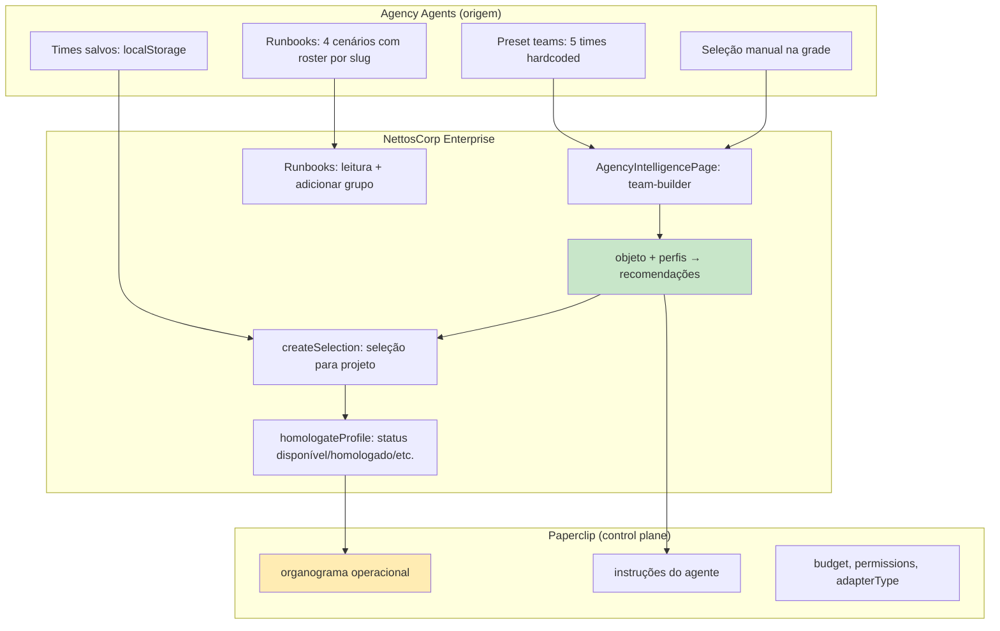

# AGENCY AGENTS — ENGENHARIA REVERSA COMPLETA — DOCUMENTO CANÔNICO

**Versão:** 1.0  
**Status:** REGISTRO DE INVESTIGAÇÃO — evidência coletada, nenhum código alterado  
**Repositório:** Tokenizaa/NettosCorp (branch `main`)  
**Caminho:** `institutional/architecture/AGENCY_AGENTS_REVERSE_ENGINEERING_CANONICAL.md`  
**Produto investigado:** Agency Agents — `msitarzewski/agency-agents-app` (Tauri 2 + Svelte, v0.3.2)  
**Cópia local investigada:** `/home/lg/workspace/NettosCorp/NettosCorp/enterprise/agency-agents/` (commit `da407fe`)  
**Corpus de agentes (instalado localmente):** `/home/lg/.agency-agents/`  
**App instalado (dados):** `/home/lg/.local/share/com.zerologic.agency-agents-app/`  
**Enterprise auditada:** `/home/lg/workspace/NettosCorp/NettosCorp/enterprise/`  
**Não implementado nesta etapa:** nenhuma alteração de código, deploy, migration, branch ou PR.

---

## 1. Objetivo e escopo

Este documento é a referência técnica e funcional oficial de engenharia reversa do **Agency Agents** para a próxima evolução da **NettosCorp Enterprise**. Ele responde, com evidência de código, a: o que cada funcionalidade faz, como funciona internamente, quais dados utiliza, quais componentes e mecanismos a sustentam, como se relaciona com outras funcionalidades, quais entradas recebe e quais resultados produz, quais regras e limitações possui, o que pode ser reutilizado na NettosCorp Enterprise e o que precisa ser reconstruído ou adaptado.

**Escopo coberto:** origem (repositório Agency Agents + app Tauri + corpus instalado), comparação com a integração existente na Enterprise (`enterprise/`), motores internos, dados, fluxos operacionais, lacunas e oportunidades para a nova arquitetura (Agency Agents → Enterprise → Paperclip).

**Escopo explicitamente fora desta etapa:** implementação da nova arquitetura, deploy, migrations do Supabase, criação de branches/PRs, implantação de agentes no Paperclip.

---

## 2. Fontes investigadas e versões

| Fonte | Caminho / URL | Versão / Commit | O que foi investigado |
|-------|---------------|-----------------|----------------------|
| Repositório Agency Agents (App) | `enterprise/agency-agents/` | `da407fe` (origin: `Tokenizaa/agency-agents-app.git`) | Código fonte completo: src, src-tauri, scripts, static, docs, tauri.conf.json |
| Corpus de agentes (instalado) | `/home/lg/.agency-agents/` | Snapshot nov/2026 | 17 divisões, ~264 agentes `.md`, divisions.json, tools.json, strategy/runbooks.json, integrations/, scripts/ |
| Dados do app instalado | `/home/lg/.local/share/com.zerologic.agency-agents-app/corpus/` | Snapshot | Espelho do corpus usado pela app em execução |
| Enterprise (integração existente) | `enterprise/` | main | `src/services/agencyCatalogService.ts`, `agencyTeamPlanner.ts`, páginas, tipos, importação de 283 perfis |
| Documentação prévia da NettosCorp | `empresa/02-organization/` | v1.0 (nov/2026) | AGENCY_AGENTS_INVESTIGACAO.md, INTEGRACAO.md, AGENCY_AGENTS_TECNOLOGIA.md, PROPOSTA_EQUIPE.md, ARQUITETURA_DEPARTAMENTAL.md |
| Script de importação Enterprise | `enterprise/extract-profiles.py` | — | Extração dos 283 perfis de `CATALOGO_GERAL_...md` para `agency-profiles-import.json` |
| Asset importado Enterprise | `enterprise/agency-profiles-import.json` | — | 283 perfis importados, categorias NettosCorp (não as 17 originais) |

**Classificação de evidência usada neste documento:**
- **Comprovado:** lido diretamente no código/fonte, com caminho de arquivo e trecho citado.
- **Inferência técnica:** dedução a partir de padrões de código observados, sem execução direta.
- **Não verificado:** não foi possível obter evidência suficiente (registrado explicitamente).

---

## 3. Visão geral do produto

O Agency Agents é um **catálogo de especialistas digitais (agentes de IA)** empacotado como app nativa desktop (Tauri 2 + SvelteKit, macOS/Linux/Windows) distribuído em `agencyagents.app`. Cada agente é um arquivo Markdown com frontmatter YAML (`name`, `description`, `color`, `emoji`, `vibe`) e um corpo estruturado (identidade, missão, regras críticas, fluxos de trabalho, exemplos, métricas). O app lê esse corpus, oferece busca/filtro por divisão, instala os agentes em 17 ferramentas de código (Claude Code, Cursor, Codex, Gemini CLI, Copilot, Qwen, OpenCode, Osaurus, Aider, Windsurf, Hermes, Kimi, Vibe, Mistral, DeepSeek, ZCode, Antigravity) e gerencia o ciclo de vida de instalação (reconciliar, atualizar, remover, rastrear, diff, exportar/importar loadout).

**Posicionamento na estratégia NettosCorp:** a Enterprise é a camada de inteligência, organização, preparação e homologação; o Paperclip é o control plane operacional dos agentes implantados. O Agency Agents é a **fonte de instrução/identidade dos agentes especialistas**, não um control plane (não gerencia tarefas, orçamentos, aprovações, org chart, heartbeats).

**Evidência:** `types.ts:334` (`Agent` interface com slug/name/description/category/emoji/color/vibe/body), `types.ts:434` (`Runbook`), `types.ts:482` (`InstallRecord`), `types.ts:502` (`InstallState` — 5 estados), `src-tauri/src/lib.rs:141-194` (registro dos comandos Tauri), `divisions.json` (17 divisões), `tools.json` (17 ferramentas).

---

## 4. Arquitetura técnica

O app segue um modelo **frontend (Svelte) ↔ backend (Rust/Tauri 2)** via `invoke()`. O backend é o "banco de dados" dos agentes: as ferramentas de código não possuem registro de instalação, então o próprio app mantém o ledger (`installs.json`), o índice do corpus (`corpus-index.json`) e o estado de instalação por ferramenta.

### 4.1 Camadas

```
┌─────────────────────────────────────────────────────────────┐
│  Frontend (SvelteKit + Vite) — src/routes, src/lib           │
│  • Stores: corpus, catalog, install, teams, runbooks, ui    │
│  • Componentes: AgentsWorkspace, Sidebar, DeploymentMatrix  │
│  • API: typed invoke() wrappers (api.ts, corpus, install)   │
└─────────────────────────────────────────────────────────────┘
                        invoke()  (Tauri IPC)
┌─────────────────────────────────────────────────────────────┐
│  Backend (Rust, Tauri 2) — src-tauri/src                    │
│  • commands/ (github, settings, updater)                    │
│  • corpus/ (parse, index, refresh, catalog source, runbooks)│
│  • install/ (ledger, reconcile, render, tools, projects)    │
│  • registry/ (tool metadata), render/ (per-tool conversion) │
│  • state/ (AppState), types/ (DTOs), util/ (fs, net, proc)  │
└─────────────────────────────────────────────────────────────┘
                        filesystem
┌─────────────────────────────────────────────────────────────┐
│  Disco: app_data_dir/                                         │
│  • corpus/<category>/<slug>.md   (cópia mantida do catálogo) │
│  • state/corpus-index.json       (índice por slug, hashes)   │
│  • state/corpus-meta.json        (versão, commit, fetchedAt) │
│  • state/catalog.json            (fonte do catálogo)         │
│  • state/installs.json           (ledger de instalações)     │
│  • backups/                      (cópia antes de sobrescrever)│
└─────────────────────────────────────────────────────────────┘
```

**Evidência:** `src-tauri/src/lib.rs:141-194` registra todos os comandos; `src-tauri/src/corpus/mod.rs:489-537` (`resolve_active` — seed do baseline, parse, index, persist); `src-tauri/src/install/mod.rs:34-39` (ledger em `installs.json`); `src-tauri/src/corpus/mod.rs:410-430` (caminhos de estado).

### 4.2 Modelo de fonte do catálogo (CatalogSource)

Três modos, discriminados em `types.ts:388-391`:
- `bundled`: cópia gerenciada pelo app (baseline embarcada em `resources/corpus-baseline/`), default, funciona offline.
- `managed`: clone que o app provisionou/possuí (default `~/.agency-agents`).
- `userClone`: clone do próprio usuário; `manage` = permissão para pull.

**Evidência:** `src/lib/stores/catalog.svelte.ts:26-164` (CatalogStore com setSource/useBundled/useClone/provisionManaged/pull), `src-tauri/src/corpus/mod.rs:438-472` (load/save_catalog_source, catalog_root).

### 4.3 Fluxo de inicialização

1. `+layout.svelte` (onMount): i18n, tema, settings, `install.reconcile()` (uma vez na raiz), `install.loadTools()`, `catalog.load()` + `loadStatus()`.
2. `ensure_corpus()` (Rust): seed do baseline se `corpus/` vazio, parse/index de `<dir>/<category>/**/<slug>.md`, grava `corpus-index.json` + `corpus-meta.json`.
3. UI renderiza o Discover grid (18 tiles de divisão) e a listagem de agentes.

**Evidência:** `src/routes/+layout.svelte:15-74`, `src-tauri/src/corpus/mod.rs:1353-1372` (`ensure_corpus` com cache em `AppState`), `src-tauri/src/corpus/mod.rs:489-537` (`resolve_active`).

---

## 5. Estrutura de diretórios (origem)

```
enterprise/agency-agents/                     # repositório agency-agents-app (commit da407fe)
├── AGENTS.md / README.md / CONTRIBUTING.md / LICENSE / SECURITY.md
├── docs/                                     # BUILD.md, PHILOSOPHY.md, PLAN.md, release-notes/, screenshots/
├── landing/                                  # página de destino (landing page)
├── memory-bank/                            # memory bank do projeto (AGENTS.md-guided)
├── scripts/                                # release-linux.sh, release.sh, release-windows.ps1
├── src/                                    # frontend Svelte
│   ├── app.css / app.html
│   ├── lib/
│   │   ├── api.ts                          # invoke wrappers (settings, github, updater)
│   │   ├── assets/                         # ícones de ferramentas (svg/png)
│   │   ├── components/                     # ~40 componentes Svelte (AgentsWorkspace, Sidebar, …)
│   │   ├── data/                           # playbook.ts, presetTeams.ts, toolRegistry.ts
│   │   ├── i18n/locales/                   # en, pt-BR, de, es, fa, fr, ja, ko, ru, tr, zh-CN, zh-TW
│   │   ├── stores/                         # catalog, corpus, install, teams, runbooks, settings, ui, …
│   │   ├── types.ts                        # TODOS os DTOs (Settings, Agent, CorpusEntry, InstallRecord, …)
│   │   └── util/                           # categoryIcon, diff, markdown, platform, token, …
│   └── routes/                             # +layout.svelte, +page.svelte (single-page app)
├── src-tauri/                              # backend Rust (Tauri 2)
│   ├── Cargo.toml                          # agency-agents-app v0.3.2, deps: tauri, serde, tokio, reqwest, …
│   ├── tauri.conf.json
│   ├── src/
│   │   ├── lib.rs                          # entrypoint, registro de comandos (invoke_handler)
│   │   ├── commands/{github,settings,updater}.rs
│   │   ├── corpus/{mod,parse}.rs           # índice, refresh via tarball, divisão, runbooks
│   │   ├── install/mod.rs                  # ledger, reconcile, render, detecção de ferramentas
│   │   ├── registry.rs                     # metadados das 17 ferramentas
│   │   ├── render/mod.rs                   # conversão por ferramenta (format/installKind)
│   │   ├── state.rs                        # AppState (corpus cache, settings, paranoid mode)
│   │   ├── types.rs                        # DTOs Rust (espelho dos types.ts)
│   │   └── util/{fs,net,process,proc}.rs
│   ├── data/                               # agency-categories.json, tools/*.json
│   └── resources/corpus-baseline/          # snapshot inicial dos agentes (<category>/<slug>.md)
├── static/                                 # favicon, svg
├── tools/                                  # phase-c scripts, release, tauri-run.mjs
├── vite.config.js / svelte.config.js / tsconfig.json
└── package.json / package-lock.json
```

**Corpus instalado (`/home/lg/.agency-agents/`):**
```
agency-agents/
├── <17 divisões>/<slug>.md                 # ~264 agentes (engineering tem 66)
├── divisions.json                          # fonte de verdade das 17 divisões (label, icon, color)
├── tools.json                              # fonte de verdade das 17 ferramentas (id, label, format, installKind, dest, …)
├── strategy/                               # NEXUS doctrine
│   ├── nexus-strategy.md                   # playbook de 7 fases, command structure, ativação
│   ├── runbooks.json                       # 4 runbooks (startup-mvp, enterprise-feature, marketing-campaign, incident-response)
│   ├── runbooks/*.md                       # prose dos 4 cenários
│   ├── playbooks/phase-0..6.md             # 7 fases operacionais
│   ├── coordination/                       # agent-activation-prompts.md, handoff-templates.md
│   ├── EXECUTIVE-BRIEF.md, QUICKSTART.md
├── integrations/<17 ferramentas>/          # saída convertida por convert.sh (ex: claude-code, codex, …)
├── scripts/                                # install.sh, convert.sh, check-*.sh, lint-agents.sh, test-*.sh
├── examples/
└── README.md
```

**Evidência:** contagem de agentes por divisão obtida via `ls` em `/home/lg/.agency-agents/*/` (engineering: 66, specialized: 59, marketing: 37, etc.); `divisions.json:4-22`; `tools.json:3-21`.

---

## 6. Mapa completo de páginas (UI da app)

A app é uma SPA (single `+page.svelte`) com 7 seções de sidebar controladas por `ui.section` (`+page.svelte:222-238`):

| # | Seção (sidebar) | Componente | Finalidade | Entradas / Ações | Dados apresentados | Estados |
|---|-----------------|------------|------------|------------------|-------------------|---------|
| 1 | dashboard | `AgencyDashboard` | Visão geral do catálogo e status | — | total de agentes, divisões, updates pendentes | loading, empty, error |
| 2 | personas (agentes) | `AgentsWorkspace` | Catálogo unificado: busca, filtro por divisão, lens de instalação, detail pane | query, categoria, lens, select agent, install/uninstall/update/track/bulk | lista de agentes, estado de instalação por ferramenta, corpo do agente | loading, empty, error, sucesso |
| 3 | tools | `ToolsView` | Ferramentas de código detectadas + superfície de implantação | selecionar ferramentas alvo | 17 ferramentas, detected, installedCount, versão | loading, empty |
| 4 | teams | `Teams` | Times salvos pelo usuário (localStorage) | criar/renomear/remover time, deploy | nome, agentes (slugs), createdAt | empty, saved |
| 5 | projects | `Projects` | Diretórios de projeto para installs escopados | adicionar/esquecer projeto | path, label, installedCount | empty |
| 6 | runbooks | `Runbooks` | Runbooks NEXUS (cenários operacionais) | selecionar runbook, adicionar grupo ao time | slug, title, mode, duration, roster por grupo | empty ("sync to unlock") |
| 7 | activity | `ActivityHistory` | Log de ações (install/uninstall/update/track/sync/bulk) | — | action, agent, tool, scope, outcome, detail | empty |

Modais/diálogos sobrepostos (não são rotas independentes): `Settings` (aparência, catálogo, rede, github, activity, about), `AboutModal`, `PlaybookModal`, `DeviceFlowModal` (GitHub OAuth device flow), `InstallModal` (grid de ferramentas × destinos), `DiffModal` (revisão antes de atualizar), `CatalogFirstRun` (escolha da fonte do catálogo), `UpdateIndicator` (titlebar).

**Evidência:** `src/routes/+page.svelte:222-238` (mapeamento seção → componente), `src/lib/types.ts:603-610` (`SidebarSection` union type), `src/lib/components/*.svelte` (40 componentes listados na seção de arquivos-fonte).

**Fluxos que começam/terminam em cada página:** dashboard → entra em qualquer seção; personas → instala agente (InstallModal) ou abre detail (DeploymentMatrix); tools → revela caminho no gerenciador de arquivos; teams → salva time; projects → registra/esquece projeto; runbooks → adiciona grupo de agentes ao time; activity → apenas leitura de log.

**Responsividade:** não há breakpoints distintos por seção; o detail pane vira overlay fixo em telas ≤860px (`AgentsWorkspace.svelte:728-740` media query).

---

## 7. Mapa de navegação

### 7.1 Estrutura de navegação (hiérarquia)

```
App Shell (+layout.svelte)
├── Titlebar (traffic lights, back/forward, toggle sidebar, section title, UpdateIndicator, TitlebarControls)
├── Sidebar (7 seções: dashboard/personas/tools/teams/projects/runbooks/activity)
│   └── atalhos de teclado: Cmd+0..6 (seta seção), Cmd+K (paleta), Cmd+, (settings)
├── Main content (section-pane, fade transition)
│   └── [componente da seção ativa]
└── Overlays: CommandPalette, Settings, AboutModal, PlaybookModal, DeviceFlowModal, Toast
```

### 7.2 Atalhos de teclado

| Atalho | Ação | Arquivo:linha |
|--------|------|---------------|
| Cmd+K | Abrir command palette | `+page.svelte:60-64` |
| Cmd+, | Abrir Settings | `+page.svelte:67-71` |
| Cmd+Shift+L | Ciclar tema (light/dark/system) | `+page.svelte:74-81` |
| Cmd+L | Alternar drawer (sidebar collapse) | `+page.svelte:84-88` |
| Cmd+[ / Cmd+] | Back / forward no histórico de navegação | `+page.svelte:91-92` |
| Cmd+0..6 | Navegar direto para seção (0=dashboard … 6=activity) | `+page.svelte:95-108` |
| Esc | Fecha settings/palette | `+page.svelte:114-117` |
| / | Foca input de filtro da vista ativa | `+page.svelte:120-126` |
| Mouse btn 3/4 | Back / forward | `+page.svelte:130-133` |

**Evidência:** `src/routes/+page.svelte:56-142`.

### 7.3 Deep-links e estado de UI

O estado de UI (`ui.svelte.ts`) persiste: seção ativa, categoria de agentes, lens de instalação, agent selecionado, sidebar collapsed/width, detail pane width, tema, secção de settings. Back/forward restaura estes. O `ui.section` é a fonte de verdade para qual componente render.

**Evidência:** `src/lib/stores/ui.svelte.ts` (não lido na íntegra, mas referenciado por `+page.svelte` e `AgentsWorkspace.svelte:107` onde `ui.agentsLens` é nav state).

---

## 8. Catálogo de funcionalidades

| Funcionalidade | O que faz | Como funciona internamente | Dados de entrada | Resultado | Arquivo-chave |
|---|---|---|---|---|---|
| Listagem de agentes | Exibe todos os agentes do catálogo ativo | `corpus_list` → `corpus.list(category)` omite `body` | categoria opcional | `Agent[]` (sem body) | `corpus.svelte.ts:53-58`, `corpus/mod.rs:1734-1741` |
| Detalhe do agente | Exibe corpo completo (persona) | `corpus_get(slug)` busca por slug, memoizado em `bodyCache` | slug | `Agent` com `body` | `corpus.svelte.ts:92-103`, `corpus/mod.rs:1745-1754` |
| Busca textual | Filtra agentes por nome/descrição/vibe | `corpus.filtered(categorySlug, query)` — match case-insensitive substring | query string + categoria | `Agent[]` ordenado por nome | `corpus.svelte.ts:156-166` |
| Filtro por divisão | 18 tiles do Discover grid | `corpus.categories()` + `corpus.tiles` (ordenado por label) | — | `Category[]` com contagem | `corpus.svelte.ts:123-131` |
| Lens de instalação | Filtra lista por estado de instalação (all/attention/current/outdated/foreign/removed/none) | `buckets(slug)` agrega estados das install rows | — | `Agent[]` filtrado | `AgentsWorkspace.svelte:111-122` |
| Seleção individual | Abre detail pane do agente | `ui.selectAgent(slug)` | slug | detail pane com PersonaBody + DeploymentMatrix | `AgentsWorkspace.svelte:236-238` |
| Seleção múltipla (bulk) | Marca agentes para ação em lote | `selected: Set<string>`, toggleRow/toggleAll | agentes | barra de bulk (install/update/track/uninstall) | `AgentsWorkspace.svelte:249-304` |
| Implantação (install) | Escreve agente em ferramenta de código | `install_agent` Tauri → render + write + ledger | slug, tool, projectPath | `InstallRecord` | `install.svelte.ts:233-264`, `install/mod.rs:579-587` |
| Atualização | Re-render + write (com backup se diferir) | `update_agent` (mesmo `do_install` do install) | slug, tool, projectPath | `InstallRecord` | `install/mod.rs:594-602` |
| Remoção | Remove arquivo(s) e ledger row (backup primeiro) | `uninstall_agent` → `remove_agent_files` | slug, tool, projectPath | vazio | `install.svelte.ts:266-296`, `install/mod.rs:667-700` |
| Rastreamento (track) | Registra install existente no ledger sem escrever | `track_agent` → `do_track` (sem escrita de arquivo) | slug, tool, projectPath | `InstallRecord` | `install.svelte.ts:336-365`, `install/mod.rs:610-618` |
| Diff (revisão prévia) | Compara on-disk vs render canônico | `agent_diff` lê arquivo e renderiza | slug, tool, projectPath | `AgentDiff` (on_disk/proposed/differs) | `install.svelte.ts:368-370`, `install/mod.rs:623-663` |
| Reconciliação | Classifica todos os installs em 5 estados | `installs_reconcile` — ledger ↔ disco ↔ corpus-index | projectRoots | `InstalledAgent[]` com estado | `install.svelte.ts:124-156`, `install/mod.rs:726-962` |
| Detecção de ferramentas | Lista 17 ferramentas + detected + versão | `tools_list` + `tool_versions` (probes `<bin> --version`) | — | `ToolInfo[]` / `ToolVersion[]` | `install.svelte.ts:158-185`, `install/mod.rs:1006-1119` |
| Projetos (escopo) | Diretórios para installs escopados | `projects_list` / `project_forget` (apenas ledger) | projectPath | `ProjectInfo[]` | `install/mod.rs:709-714, 1122-1145` |
| Loadout (Agentfile) | Exporta/importa conjunto de installs | `loadout_export` / `loadout_import` (JSON) | caminho | contagem / `InstallRecord[]` | `install.svelte.ts:461-471`, `install/mod.rs:1170-1212` |
| Catálogo (fonte) | Gerencia bundled/managed/userClone | `catalog_source_*` comandos | `CatalogSource` | `CorpusMeta` / `CatalogStatus` | `catalog.svelte.ts`, `corpus/mod.rs:1421-1666` |
| Refresh do catálogo | Baixa tarball do GitHub, re-indexa | `corpus_refresh` → `download_corpus_tarball` + `extract_categories` | — | `CorpusMeta` | `corpus/mod.rs:1387-1418, 915-1075` |
| Runbooks (NEXUS) | Lista cenários de composição de equipes | `runbooks_list` lê `strategy/runbooks.json` | — | `Runbook[]` | `runbooks.svelte.ts`, `corpus/mod.rs:1706-1719` |
| GitHub (stats/auth/issue) | Repo stats, device flow, criar issue | `github_*` comandos (Rust `github/`) | homepage/token | `RepoStats` / `DeviceFlowPoll` / `CreatedIssue` | `api.ts:88-175`, `commands/github.rs` |
| Settings | Preferências (paranoid mode, GitHub, updates) | `settings_get/set/reset` (arquivo JSON) | `Settings` | `Settings` | `api.ts:53-73`, `commands/settings.rs` |
| Updater | Verifica/instala nova versão | `update_check_now/install/skip/relaunch` | versão | `UpdateCheckOutcome` | `api.ts:188-215`, `commands/updater.rs` |
| Atividade | Log de ações mutantes | `activity.log()` (local, in-memory) | ação/agente/ferramenta/resultado | linhas de log | `activity.svelte.ts` |

**Limitações do catálogo:** não há mecanismo nativo de delegação entre agentes; não há skills compartilháveis (cada agente é autocontido); não há orçamento/custo por agente; não há heartbeat/liveness; não há persistencia de contexto entre sessões; não há hierarquia organizacional (não é control plane).

**Evidência:** `INVESTIGACAO.md:204-208, 234-244` (limitações); `types.ts:502` (5 estados de instalação); `tools.json` (17 ferramentas com `installKind`: per-agent/roster/plugin).

---

## 9. Biblioteca e modelo de agentes

### 9.1 Representação de um agente

Cada agente é um único arquivo Markdown `<division>/<slug>.md` com:

- **Frontmatter YAML** (`--- … ---`): `name`, `description`, `color`, `emoji`, `vibe`.
- **Corpo Markdown**: Identidade & memória, missão principal, regras críticas, processos/fluxos, estilo de comunicação, exemplos de código/entregáveis, métricas de sucesso.

**Evidência:** `types.ts:334-351` (`Agent` interface); `.agency-agents/engineering/engineering-backend-architect.md:1-255` (exemplo completo: frontmatter name=Backend Architect, description, color=blue, emoji=🏗️, vibe; corpo com Identidade & Memory, Core Mission, Critical Rules).

### 9.2 Identificador

O `slug` é o nome do arquivo sem `.md` (ex: `engineering-backend-architect`). É o ID de corpus, estável e renome-proof (runbooks referenciam slugs, não nomes de exibição). Há risco de colisão de slug entre divisões — o indexer mantém o primeiro e marca duplicatas como `duplicateSlug`.

**Evidência:** `types.ts:336` (`slug` doc), `runbooks.json:2` (nota: rostros referenciam slugs), `corpus/mod.rs:656-669` (duplicateSlug skip reason, first wins).

### 9.3 Metadados (frontmatter)

| Campo | Tipo | Uso |
|-------|------|-----|
| `name` | string | Nome de exibição do agente |
| `description` | string | Descrição curta da especialidade (busca) |
| `color` | string | Cor da marca (hex ou nome) para tiles/pills |
| `emoji` | string | Emoji de identificação visual na listagem |
| `vibe` | string | Frase de personalidade |

**Evidência:** `types.ts:338-349` (documentação de cada campo); `divisions.json:4-22` (cor/ícone da divisão, não do agente individual).

### 9.4 Operações sobre a biblioteca

- **Listagem:** `corpus_list` (opcionalmente filtrado por categoria), corpo omitido.
- **Detalhe:** `corpus_get(slug)`, corpo incluído, memoizado.
- **Busca:** client-side substring sobre `name + description + vibe`.
- **Importação/exportação (de agentes):** não há no app; o app *instala* agentes em ferramentas e *exporta/importa loadouts* (conjunto de installs, não os agentes em si).
- **Atualização/versionamento:** por `sourceHash`/`frontmatterHash`/`bodyHash` em `CorpusEntry`; `InstallRecord` carrega `sourceHash`, `bodyHash`, `renderedHash`, `corpusVersion`. Reconciliação classifica como `outdated` quando `corpus.source_hash ≠ record.source_hash`.
- **Integridade/proveniência:** `CorpusEntry.sourceHash` (SHA-256 do .md completo), `frontmatterHash`, `bodyHash`; `SkippedFile` registra arquivos não indexados com motivo (`unreadable`, `notUtf8`, `unclosedFrontmatter`, `invalidYaml`, `missingName`, `duplicateSlug`).

**Evidência:** `types.ts:358-372` (`CorpusEntry`), `types.ts:482-495` (`InstallRecord`), `types.ts:414-430` (`SkippedFile`/`SkipReason`), `corpus/mod.rs:604-682` (`build_from_dir` com skip reasons), `install/mod.rs:501-518` (`classify` função dos 5 estados).

---

## 10. Taxonomia e divisões

O Agency Agents organiza agentes em **17 divisões planas** (não há hierarquia entre divisões; não há "departamentos" internos). Cada divisão tem label, ícone Lucide (PascalCase) e cor hex. Definida em `divisions.json` e validada por CI (`scripts/check-divisions.sh` falha se divergir de diretórios no disco, `AGENT_DIRS` em `convert.sh`/`lint-agents.sh`, e filtros em `lint-agents.yml`).

| Divisão | Label | Ícone | Cor | Agentes (corpus instalado) |
|---------|-------|-------|-----|---------------------------|
| academic | Academic | GraduationCap | #8B5CF6 | 6 |
| design | Design | PenTool | #EC4899 | 10 |
| engineering | Engineering | Code | #3B82F6 | 66 |
| finance | Finance | DollarSign | #22C55E | 5 |
| game-development | Game Development | Gamepad2 | #A855F7 | 6 |
| gis | GIS | Map | #14B8A6 | 13 |
| healthcare | Healthcare | Stethoscope | #0D9488 | 3 |
| marketing | Marketing | Megaphone | #F97316 | 37 |
| paid-media | Paid Media | Target | #EAB308 | 7 |
| product | Product | Box | #D946EF | 6 |
| project-management | Project Management | ClipboardList | #0EA5E9 | 7 |
| research | Research | Search | #7C3AED | 1 |
| sales | Sales | TrendingUp | #10B981 | 9 |
| security | Security | ShieldCheck | #EF4444 | 12 |
| spatial-computing | Spatial Computing | Boxes | #06B6D4 | 6 |
| specialized | Specialized | Sparkles | #6366F1 | 59 |
| support | Support | LifeBuoy | #84CC16 | 6 |
| testing | Testing | FlaskConical | #F59E0B | 9 |
| **Total** | | | | **~264** |

**Nota:** `strategy/` (playbooks/runbooks) e `integrations/` (saída do convert.sh) NÃO são divisões (excluídos via `NON_DIVISION_DIRS` em `check-divisions.sh`). `examples/` também não é divisão.

**Mapeamento Enterprise:** a Enterprise re-categoriza os 283 perfis importados em 18 categorias corporativas (`strategy`, `operations`, `technology`, `governance`, `finance`, `human-resources`, `legal`, `marketing`, `sales`, `product`, `research`, `security`, `compliance`, `data`, `infrastructure`, `customer-success`, `communications`, `other`) via `CATEGORY_MAP` em `extract-profiles.py:12-31`. Isso é uma **adaptação**, não uma reutilização direta da taxonomia original.

**Evidência:** `divisions.json:2-22` (nota + 17 divisões); `types.ts:265-283` (`AgencyAgentCategory` da Enterprise com 18 categorias diferentes); `extract-profiles.py:12-31` (CATEGORY_MAP); `INTEGRACAO.md:69-76` (proposta de mapeamento divisões → departamentos).

---

## 11. Busca e indexação

### 11.1 Indexação do corpus

O backend constrói um índice em memória (`Corpus` struct, `corpus/mod.rs:178-289`) e grava `corpus-index.json` (BTreeMap por slug para ordem estável). Cada `CorpusEntry` tem `sourceHash` (SHA-256 do .md completo), `frontmatterHash`, `bodyHash`. O índice é determinístico: `index_json` produz bytes idênticos para corpus inalterado (teste `index_json_is_byte_stable_across_builds`).

**Evidência:** `corpus/mod.rs:184-189` (index BTreeMap), `284-288` (index_json determinístico), `tests:1896-1915` (byte stability), `types.ts:358-372` (CorpusEntry com 3 hashes).

### 11.2 Como a busca funciona

A busca é **client-side, substring, case-insensitive**, sobre `name + description + vibe`. Não há índice invertido, não há ponderação (TF-IDF), não há busca fuzzy. Ordenação alfabética por nome.

**Evidência:** `corpus.svelte.ts:156-166` (`filtered` método).

### 11.3 Campos pesquisáveis

| Campo | Pesquisável? | Como |
|-------|-------------|------|
| `name` | Sim | substring no `filtered` |
| `description` | Sim | substring no `filtered` |
| `vibe` | Sim | substring no `filtered` |
| `body` (persona completa) | Não (na listagem) | só disponível via `corpus_get` após seleção |
| `category` | Como filtro, não como busca | `categorySlug` parâmetro de `filtered` |
| hashes / metadados | Não | internos, não expostos à busca |

### 11.4 Interação filtros × busca

Filtro por categoria é aplicado primeiro (`categorySlug`), depois a substring de busca sobre o resultado filtrado. Contagens por divisão (`tiles`) vêm de `corpus.categories()` (contagem do backend) ou derivada da lista carregada.

**Evidência:** `corpus.svelte.ts:126` (`base = corpus.filtered(ui.agentsCategory, query)`), `123-131` (`tiles` com contagem).

### 11.5 Ordenação

Alfabética por `name` (`localeCompare`). Não há ordenação por relevância, popularidade, data ou score.

**Limitação:** não há indexação de conteúdo completo do corpo (`body`), então termos que aparecem apenas na persona detalhada não são encontrados pela busca da grade.

**Evidência:** `corpus.svelte.ts:161-163` (haystack = name + description + vibe, não body).

---

## 12. Motores de inteligência

O Agency Agents **não possui motor de LLM nem de recomendação algorítmica integrado**. A "inteligência" está em:

1. **NEXUS doctrine** (`strategy/nexus-strategy.md`): doutrina de orquestração multi-agente com 7 fases (Discovery → Strategize → Scaffold → Build → Harden → Launch → Operate), command structure (Agents Orchestrator → Studio Producer/Project Shepherd/Senior PM → Division Leads), 3 modos de ativação (Full/Sprint/Micro), quality gates entre fases, handoff protocols.
2. **Runbooks** (`strategy/runbooks.json`): 4 cenários (startup-mvp, enterprise-feature, marketing-campaign, incident-response) com roster de agentes por grupo e timing de ativação (always / week 3+ / as needed / post-fix).
3. **Playbooks** (`strategy/playbooks/phase-0..6.md`): procedimentos por fase.
4. **Coordination** (`strategy/coordination/`): `agent-activation-prompts.md`, `handoff-templates.md`.
5. **Preset teams** (`src/lib/data/presetTeams.ts`): 5 times pré-definidos (mobile-launch, ship-web-app, growth-squad, product-discovery, ai-builders) com slugs de agentes.
6. **Playbook práticas** (`src/lib/data/playbook.ts`): 5 hábitos (outcome, team, tested, context, scale) + starter prompts + division prompts.

Não há LLM, não há pontuação automática de competências, não há detecção de lacunas automatizada, não há recomendação baseada em dados de uso. A seleção de equipes é manual (usuário escolhe) ou por runbook (roster pré-definido).

**Evidência:** `nexus-strategy.md:27-93` (7 fases, command structure); `runbooks.json:3-175` (4 runbooks com roster); `presetTeams.ts:31-99` (5 preset teams); `playbook.ts:16-42` (5 práticas); `INTEGRACAO.md:204-208` (Agency Agents não tem delegação nem recomendação nativa).

**Classificação:** Motor de inteligência = **não verificado como existente no código** (existe como documentação/doutrina NEXUS, não como código executável). A lógica de recomendação existe apenas na **Enterprise** (`agencyTeamPlanner.ts`), não na origem.

---

## 13. Recomendação e seleção

### 13.1 Na origem (Agency Agents)

Não existe recomendação automática. Seleção é manual via UI:
- Usuário navega a grade de divisões, filtra por busca, seleciona um agente individual (detail pane).
- Seleção múltipla (bulk) para instalar/atualizar/rastrear/remover vários de uma vez.
- Implantação de divisão inteira (`Deploy Division` na division overview banner).
- Implantação de preset team (5 times pré-definidos).
- Implantação de runbook (roster de um cenário NEXUS).

### 13.2 Na Enterprise (agencyTeamPlanner.ts)

A Enterprise implementa um **planejador determinístico e explicável** (`recommendTeamComposition`):
- Recebe objetivo (texto), perfis, runbooks, e texto de busca original por código.
- Detecta cenário por regras de palavra-chave (`SCENARIO_RULES`: incident-response, marketing-campaign, enterprise-feature, startup-mvp).
- Detecta domínios de capacidade do objetivo (`DOMAIN_TERMS`: 12 domínios).
- Faz match textual de tokens entre objetivo e perfis (nome, código, identidade, specialty, competencies, responsibilities, methodology, personalidade).
- Score = `objectiveFit * 0.55 + runbookFit * 0.25 + domainFit * 0.20`, limitado a 18 recomendações com diversificação de domínios.
- Produz análise com forças, riscos, cobertura de domínios, phases (do runbook selecionado), e selectionGuidance.

**É determinístico, não é LLM.** Não avalia senioridade, disponibilidade, custo, ou desempenho. Documenta que "os percentuais representam aderência textual e estrutural, não probabilidade de sucesso".

**Evidência:** `agencyTeamPlanner.ts:118-238` (função completa, score, regras de cenário, domínios, score fórmula, limitações documentadas em comentários: "não se apresenta como LLM nem como avaliação de senioridade/disponibilidade").

### 13.3 Diferença

| Aspecto | Agency Agents (origem) | Enterprise |
|---------|----------------------|------------|
| Recomendação automática | Não existe | Sim (determinístico, textual) |
| Seleção baseada em runbook | Sim (rostos pré-definidos) | Parcial (adiciona grupo do runbook ao time) |
| Score/ranking | Não | Sim (0-1, com dimensões) |
| Detecção de lacunas de competência | Não | Parcial (uncoveredDomains) |
| Persistência de equipe | localStorage (times salvos) | Supabase/localStore (seleções por projeto) |

---

## 14. Composição de equipes

### 14.1 Na origem

Equipes são formadas por:
- **Preset teams** (5, hardcoded em `presetTeams.ts`): conjuntos de slugs para objetivos móvel, web, growth, product discovery, AI builders.
- **Runbooks** (4, `runbooks.json`): roster dividido em grupos com ativação (Core Team always, Growth Team week 3+, Support as needed, etc.).
- **Times salvos pelo usuário** (`TeamsStore`, localStorage `agency-agents:teams:v1`): nome + lista de slugs, criado via `save()`.
- **Implantação de divisão inteira** (AgentsWorkspace division overview banner → InstallModal com todos os slugs da divisão).

Não há hierarquia entre agentes em uma equipe, não há `reports_to`, não há papéis definidos dentro da equipe (são especialistas independentes). A colaboração é implícita (usuário/orquestrador da ferramenta destino decide quem ativa).

**Evidência:** `presetTeams.ts:31-99`; `runbooks.json:3-175`; `teams.svelte.ts:31-80` (SavedTeam com id/name/agents/createdAt); `INVESTIGACAO.md:204-208` (sem mecanismo nativo de delegação, sem reports_to).

### 14.2 Na Enterprise

A Enterprise compõe equipes via:
- `AgencyIntelligencePage` tab `team-builder`: usuário adiciona profissionais recomendados ou carrega grupo de runbook; salva seleção para um projeto (`createSelectionAsync`).
- Seleções são registradas com `status: 'planejado'` e vinculadas a `project_name` e `purpose`.
- Não cria agentes operacionais no Paperclip (apenas planejamento).

**Evidência:** `AgencyIntelligencePage.tsx:117-142` (`saveTeam`), `98-115` (`addRunbookGroup`), `agencyCatalogService.ts:510-599` (createSelection).

### 14.3 Comparação de composição

| Elemento | Agency Agents | Enterprise | Status na Enterprise |
|----------|--------------|------------|---------------------|
| Times pré-definidos | 5 preset teams | Não tem | Ausente |
| Runbooks com roster | 4 cenários NEXUS | Importados (runbooks.json) | Parcial (apenas leitura/adicionar grupo) |
| Times salvos pelo usuário | localStorage | Seleções por projeto (Supabase/localStore) | Adaptado |
| Hierarquia/reports_to na equipe | Não existe | Não existe | Ausente (ambos) |
| Persistência de equipe | local (app) | remota (Supabase) | Adaptado |
| Agente orquestrador de pipeline | `agents-orchestrator` (especialized) | Não mapeado | Não verificado |

---

## 15. Runbooks e metodologias

### 15.1 Estrutura dos runbooks

Cada runbook (em `strategy/runbooks.json` e `strategy/runbooks/*.md`):
- `slug`, `title`, `mode` (NEXUS-Sprint / NEXUS-Micro), `duration`, `summary`, `doc` (caminho do prose md), `roster[]`.
- `roster[]` = grupos com `group` (nome), `activation` (timing), `agents[]` (slugs).

**Evidência:** `runbooks.json:3-175` (4 runbooks completos); `types.ts:434-450` (`Runbook`/`RunbookGroup` interfaces).

### 15.2 Runbooks disponíveis

| Slug | Título | Modo | Duração | Agentes (total) | Grupos |
|------|--------|------|---------|-----------------|--------|
| startup-mvp | Startup MVP Build | NEXUS-Sprint | 4-6 semanas | ~18 | Core Team (always), Growth Team (week 3+), Support Team (as needed) |
| enterprise-feature | Enterprise Feature Development | NEXUS-Sprint | 6-12 semanas | ~19 | Core Team, Compliance & Governance, Quality Assurance |
| marketing-campaign | Multi-Channel Marketing Campaign | NEXUS-Sprint | 2-4 semanas | ~15 | Campaign Core, Platform Specialists, Support |
| incident-response | Incident Response | NEXUS-Micro | Minutos a horas | ~10 | P0 Critical Response (always), Verification & Post-Mortem (post-fix) |

### 15.3 Relação cenário ↔ agentes

Cada agente do roster é referenciado por **slug** (resolve contra o corpus). Slugs que não existem no catálogo ativo são silenciosamente ignorados no deploy (degradação graciosa). O `doc` aponta para o arquivo de prose com execução semana-a-semana, decisões, critérios de sucesso, pitfalls.

**Evidência:** `runbooks.json:2` (nota sobre slugs); `presetTeams.ts:7` (comentário sobre slugs não presentes sendo silenciosamente skipados); `scenario-startup-mvp.md:1-154` (execução detalhada por semana).

### 15.4 Regras de composição / sequenciamento

- NEXUS 7 fases com quality gate entre cada fase.
- Activation modes: Full / Sprint / Micro (tamanho do time).
- Command structure: Agents Orchestrator (pipeline controller) → division leads → agentes.
- Handoff protocols e agent-activation prompts em `strategy/coordination/`.

### 15.5 Critérios de aplicação

Um runbook é selecionado pelo usuário manualmente na UI (tab Runbooks). Não há detecção automática de qual runbook aplicar com base no contexto (na origem). A Enterprise detecta cenário por palavras-chave (`SCENARIO_RULES`) e sugere o runbook.

**Evidência:** `AgencyIntelligencePage.tsx:84-89` (composition memo que chama `recommendTeamComposition` e seta `inferredRunbook`); `agencyTeamPlanner.ts:53-58` (SCENARIO_RULES).


---

## 16. Instalação e gerenciamento

### 16.1 Ferramentas suportadas (17)

Definidas em `tools.json` e `src-tauri/data/tools/*.json`, validadas por CI (`check-tools.sh`). Cada entrada: `id` (camelCase), `label`, `format` (renderer contract), `installKind` (per-agent / roster / plugin), `scope` (user/project), `detect` (dirs), `dest` (templates com `{slug}`), `version` (bin + args).

| # | Ferramenta | id | format | installKind | escopo user | escopo project | destino (user) |
|---|-----------|----|--------|-------------|-------------|----------------|----------------|
| 1 | Claude Code | claudeCode | identity | per-agent | sim | sim | `.claude/agents/{slug}.md` |
| 2 | Codex | codex | codex-toml | per-agent | sim | sim | `.codex/agents/{slug}.toml` |
| 3 | Gemini CLI | geminiCli | gemini-md | per-agent | sim | sim | `.gemini/agents/{slug}.md` |
| 4 | GitHub Copilot | copilot | identity | per-agent | sim | sim | `.copilot/agents/{slug}.md` / `.github/agents/{slug}.md` |
| 5 | Qwen | qwen | qwen-md | per-agent | sim | sim | `.qwen/agents/{slug}.md` |
| 6 | Cursor | cursor | cursor-mdc | per-agent | não | sim | `.cursor/rules/{slug}.mdc` |
| 7 | OpenCode | opencode | opencode-md | per-agent | sim | sim | `.config/opencode/agents/{slug}.md` |
| 8 | Osaurus | osaurus | skill-md | per-agent | sim | não | `.osaurus/skills/{slug}/SKILL.md` |
| 9 | Aider | aider | aider-conventions | roster | não | sim | `CONVENTIONS.md` |
| 10 | Antigravity | antigravity | skill-md | per-agent | sim | sim | `.gemini/config/skills/{slug}/SKILL.md` |
| 11 | Kimi | kimi | kimi-agent | per-agent | sim | não | `.config/kimi/agents/{slug}/agent.yaml` + `system.md` |
| 12 | OpenClaw | openclaw | openclaw-workspace | per-agent | sim | não | `.openclaw/agency-agents/{slug}/{SOUL,AGENTS,IDENTITY}.md` |
| 13 | Windsurf | windsurf | windsurf-rules | roster | não | sim | `.windsurfrules` |
| 14 | Hermes | hermes | hermes-router-plugin | plugin | sim | não | `.hermes/plugins/agency-agents-router` |
| 15 | Vibe | vibe | vibe-toml | per-agent | sim | sim | `.vibe/agents/{slug}.toml` + `.vibe/prompts/{slug}.md` |
| 16 | ZCode | zcode | zcode-md | per-agent | sim | sim | `.zcode/agents/{slug}.md` |
| 17 | DeepSeek Harness | dsh | skill-md | per-agent | sim | sim | `.dsh/skills/{slug}/SKILL.md` |

**Evidência:** `tools.json:3-21` (comentário de cabeçalho documenta o contrato: format, installKind, dest, slugFrom, slugPrefix); `src-tauri/src/install/mod.rs:552-565` (`detect` função), `1006-1041` (`tools_list` comando).

### 16.2 Formatos de renderização (`format`)

O `format` é o contrato de renderização: dois tools com o mesmo `format` produzem saída byte-identica. Formatos: `identity` (copia o .md verbatim — Claude Code, Copilot), `codex-toml`, `gemini-md`, `qwen-md`, `cursor-mdc`, `opencode-md`, `skill-md` (Osaurus, Antigravity, DeepSeek — com `slugPrefix: "agency-"`), `aider-conventions` (roster, `CONVENTIONS.md`), `kimi-agent` (agent.yaml + system.md), `openclaw-workspace` (3 arquivos: SOUL/AGENTS/IDENTITY), `windsurf-rules` (roster, `.windsurfrules`), `hermes-router-plugin` (plugin, CLI-only), `vibe-toml`, `zcode-md`.

**Evidência:** `tools.json` (cada entry tem `format` e `installKind`); `src-tauri/src/render/mod.rs` (camada de render, referenciado por `install/mod.rs`).

### 16.3 Mecanismos de instalação

Comandos Tauri (todos em `src-tauri/src/install/mod.rs`):
- `install_agent(slug, tool, projectPath)` — renderiza + escreve arquivo(s) + grava ledger. Backup se arquivo pré-existente e diferir.
- `update_agent(slug, tool, projectPath)` — idêntico ao install (re-render + write), intenção distinta no UX.
- `uninstall_agent(slug, tool, projectPath)` — remove arquivo(s) + remove ledger row; backup do conteúdo modificado antes de apagar; remove diretório órfão para skill-md (dir-unit).
- `track_agent(slug, tool, projectPath)` — registra no ledger **sem escrever nada** (substituto seguro do antigo "Adopt"); reconcilição então classifica como Current/Modified.
- `agent_diff(slug, tool, projectPath)` — compara on-disk vs render canônico, sem gravar (revisão antes de atualizar).
- `installs_reconcile(projectRoots)` — classifica todos os ledger rows em 5 estados + foreign sweep (adota installs byte-identicas feitas fora do app, ex: via CLI install.sh).
- `project_forget(projectPath)` — remove ledger rows do projeto sem tocar nos arquivos.
- `tools_list` / `tool_versions` — detecção de ferramentas + versões.
- `loadout_export(path)` / `loadout_import(path)` — Agentfile JSON (versão 1) para exportar/importar conjunto de installs.

### 16.4 Modelo de 5 estados de instalação (reconciliação)

`classify()` (`install/mod.rs:501-518`):
1. `current` — arquivo no disco existe, bytes batem com o render canônico, e `corpus.source_hash == record.source_hash`.
2. `outdated` — arquivo bate com render, mas corpus avançou (`source_hash` diferente) OU renderer mudou.
3. `modified` — arquivo existe mas bytes diferem do render (usuário editou).
4. `removed` — ledger row existe mas arquivo sumiu do disco.
5. `foreign` — arquivo reconhecido como agente do corpus mas não está no ledger (instalado por outra fonte).

**Evidência:** `types.ts:502-507` (`InstallState` union), `install/mod.rs:501-518` (`classify`), `install/mod.rs:726-962` (`installs_reconcile` com foreign sweep e adoption).

### 16.5 Instalação exclusivamente desktop vs negócio adaptável

- **Exclusivo desktop:** detecção de binário no PATH (`<bin> --version`), gravação em diretórios hidden do usuário (`~/.claude/agents`, etc.), macOS Keychain (GitHub OAuth), vibrancy de janela (NSVisualEffectView), menu bar do macOS, updater com minisign assinatura. Isso pertence ao ambiente desktop da app Tauri.
- **Adaptável para Enterprise/Paperclip:** conceito de ledger de instalações, reconciliação de estado (current/outdated/modified/removed/foreign), backup antes de sobrescrever, exportação/importação de loadout (Agentfile), detecção de ferramentas alvo, escopo user vs project, catalog source (bundled/managed/userClone), versionamento por hash (source/body/rendered).

**Evidência:** `src-tauri/src/lib.rs:119-138` (setup: window state, vibrancy macOS, auto-check scheduler); `types.ts:660-670` (`ToolInfo` com detected/user_dest/custom_path); `INTEGRACAO.md:148-159` (matriz de funcionalidades que exigem desenvolvimento próprio para integração Agency Agents → Paperclip).

---

## 17. Modelo de dados

### 17.1 Entidades da origem (Agency Agents)

| Entidade | Atributos-chave | Persistência | Arquivo |
|----------|----------------|--------------|---------|
| Agente (corpus) | slug, name, description, category, emoji, color, vibe, body | arquivo `.md` + `corpus-index.json` | `types.ts:334-351`, `corpus/mod.rs` |
| CorpusEntry | slug, name, category, emoji, color, vibe, description, sourceHash, frontmatterHash, bodyHash | `corpus-index.json` | `types.ts:358-372` |
| CorpusMeta | version, commit, fetchedAt, count | `corpus-meta.json` | `types.ts:375-380` |
| CatalogSource | kind (bundled/managed/userClone) + path + manage | `state/catalog.json` | `types.ts:388-391` |
| CatalogStatus | source, root, isGit, branch, commit, lastCommit*, dirtyCount, remoteUrl, repoSlug, version, fetchedAt, agentCount, skipped | em memória (comando) | `types.ts:394-411` |
| InstallRecord | slug, tool, scope, projectPath, dest, sourceHash, bodyHash, renderedHash, installedAt, corpusVersion | `state/installs.json` | `types.ts:482-495` |
| InstalledAgent | InstallRecord + state (5 estados) + updateKind + tracked | vista computada (reconciliação) | `types.ts:518-531` |
| AgentDiff | slug, tool, projectPath, dest, onDisk, proposed, differs | transiente (comando) | `types.ts:535-546` |
| ToolInfo | tool, label, detected, scope, userDest, installedCount, customPath | transiente (comando) | `types.ts:550-560` |
| Runbook | slug, title, mode, duration, summary, doc, roster[] | `strategy/runbooks.json` | `types.ts:434-450` |
| Settings | paranoidMode, catalogStaleBannerDays, caskIconMode, trendingTtlMinutes, githubEnabled, aiFeaturesEnabled, updateAutoCheck, enhancedTrendingEnabled, vulnerabilityScanningEnabled, liveEnrichmentEnabled, toolPaths | `settings.json` (app_data_dir) | `types.ts:26-89` |
| UpdateInfo / UpdateCheckOutcome | version, currentVersion, notes, pubDate, skipped / upToDate-available | transiente | `types.ts:195-228` |

### 17.2 Entidades da Enterprise (catálogo importado)

| Entidade | Atributos-chave | Persistência | Arquivo |
|----------|----------------|--------------|---------|
| AgencyAgentProfile | id, organization_id, category (18 cats), specialty, name, code, identity, specialty_description, competencies[], personality, responsibilities[], methodology, status (disponivel/em_avaliacao/homologado/nao_recomendado), homologated_at/by/notes, source_file, source_hash, created_at, updated_at | Supabase `agency_agent_profiles` + localStore | `types/index.ts:289-310`, `agencyCatalogService.ts` |
| AgencyAgentSelection | id, organization_id, profile_id, profile_code, project_name, purpose, selected_by, selected_by_name, selected_at, status (planejado/ativo/concluído/cancelado), notes | Supabase `agency_agent_selections` + localStore | `types/index.ts:312-326` |
| AgencyAgentHomologation | id, organization_id, profile_id, profile_code, status, reviewed_by, reviewed_by_name, reviewed_at, notes | Supabase `agency_agent_homologations` + localStore | `types/index.ts:328-340` |
| AIAgent (Paperclip-style) | id, organization_id, code, name, model, purpose, status, version, config (temperature, max_tokens, system_prompt, capabilities) | Supabase | `types/index.ts:88-107` |

### 17.3 Relações

**Origem:** não há relacionamentos formais entre agentes (sem reports_to, sem equipe como entidade, sem projeto). Times e runbooks são estruturas de dados estáticas (JSON/TS), não entidades persistidas com relacionamento.

**Enterprise:** `AgencyAgentSelection` liga um `profile_id` a um `project_name` (string, não FK para projeto) e `selected_by` (usuário). `AgencyAgentHomologation` liga a um profile e muda seu `status`. Não há FK rígida para projetos (project_name é texto livre).

### 17.4 Identificadores e versionamento

- Origem: `slug` = nome do arquivo (estável). `sourceHash`/`bodyHash` para versionamento de conteúdo. `corpusVersion` estampa cada `InstallRecord`.
- Enterprise: `id` (gerado `agt-<timestamp>-<random>`), `code` (slugificado do nome), `source_hash` (SHA-256 do source_file truncado a 16 hex). Não há versionamento de conteúdo dos perfis importados (o hash é do caminho do arquivo, não do conteúdo do agente).

**Evidência:** `types.ts:336` (slug), `types.ts:358-372` (hashes), `types.ts:482-495` (InstallRecord com corpusVersion), `types/index.ts:289-310` (AgencyAgentProfile com source_hash), `extract-profiles.py:126` (source_hash = SHA-256 de source_file[:16]).

### 17.5 Cache e persistência

- Origem: `corpus-index.json` (índice, disco), `corpus-meta.json` (meta, disco), `installs.json` (ledger, disco), `backups/` (cópias antes de sobrescrever), `settings.json` (config), `state/catalog.json` (fonte do catálogo). Corpus em memória (Arc<Corpus> no AppState) após primeira carga.
- Enterprise: Supabase (PostgreSQL) como fonte de verdade remota; `localStore` (localStorage) como fallback offline; `agency-profiles-import.json` como asset público para seed inicial dos 283 perfis.

**Evidência:** `corpus/mod.rs:410-430` (caminhos de estado), `install/mod.rs:36-39` (ledger path), `install/mod.rs:112-115` (backups_dir), `agencyCatalogService.ts:17-18, 28-54` (PUBLIC_CATALOG_URL + ensureCatalogFromPublicAsset).

---

## 18. APIs e contratos

A app expõe comandos Tauri via `invoke()` (IPC bidirecional frontend↔Rust). Não há REST API no produto de origem (é desktop local). A Enterprise expõe serviços TypeScript (não HTTP) que abstraem Supabase/localStore.

### 18.1 Contratos Tauri (origem)

| Comando | Parâmetros | Retorno | Módulo Rust |
|---------|-----------|---------|-------------|
| `app_version` | — | string | `lib.rs` / `commands/` |
| `settings_get`/`set`/`reset` | Settings | Settings | `commands/settings.rs` |
| `github_repo_stats` | homepage | RepoStats \| null | `commands/github.rs` |
| `github_status` | — | GithubStatus | `commands/github.rs` |
| `github_signin_start` | — | DeviceFlowStart | `commands/github.rs` |
| `github_signin_poll` | deviceCode | DeviceFlowPoll | `commands/github.rs` |
| `github_signout` | — | void | `commands/github.rs` |
| `github_star`/`unstar`/`is_starred`/`watch`/`unwatch` | homepage | void/boolean | `commands/github.rs` |
| `github_create_issue` | homepage,title,body,labels | CreatedIssue | `commands/github.rs` |
| `update_check_now` | — | UpdateCheckOutcome | `commands/updater.rs` |
| `update_install`/`skip`/`relaunch` | versão | void | `commands/updater.rs` |
| `corpus_status` | — | CorpusMeta | `corpus/mod.rs` |
| `corpus_refresh` | — | CorpusMeta | `corpus/mod.rs` |
| `corpus_list` | category? | Agent[] | `corpus/mod.rs` |
| `corpus_get` | slug | Agent | `corpus/mod.rs` |
| `corpus_categories` | — | Category[] | `corpus/mod.rs` |
| `catalog_source_get` | — | CatalogSource | `corpus/mod.rs` |
| `catalog_configured` | — | boolean | `corpus/mod.rs` |
| `catalog_source_set` | source | CorpusMeta | `corpus/mod.rs` |
| `catalog_detect` | scan | CatalogDetection | `corpus/mod.rs` |
| `catalog_provision_managed` | — | CorpusMeta | `corpus/mod.rs` |
| `catalog_pull` | — | CorpusMeta | `corpus/mod.rs` |
| `catalog_status` | — | CatalogStatus | `corpus/mod.rs` |
| `catalog_check_updates` | — | CatalogUpdateCheck | `corpus/mod.rs` |
| `runbooks_list` | — | Runbook[] | `corpus/mod.rs` |
| `install_agent` | slug,tool,projectPath | InstallRecord | `install/mod.rs` |
| `update_agent` | slug,tool,projectPath | InstallRecord | `install/mod.rs` |
| `track_agent` | slug,tool,projectPath | InstallRecord | `install/mod.rs` |
| `agent_diff` | slug,tool,projectPath | AgentDiff | `install/mod.rs` |
| `uninstall_agent` | slug,tool,projectPath | void | `install/mod.rs` |
| `project_forget` | projectPath | void | `install/mod.rs` |
| `installs_reconcile` | projectRoots | InstalledAgent[] | `install/mod.rs` |
| `installs_for_agent` | slug | InstallRecord[] | `install/mod.rs` |
| `tools_list` | — | ToolInfo[] | `install/mod.rs` |
| `tool_versions` | — | ToolVersion[] | `install/mod.rs` |
| `reveal_path` | path | void | `install/mod.rs` |
| `projects_list` | — | ProjectInfo[] | `install/mod.rs` |
| `loadout_export` | path | u32 | `install/mod.rs` |
| `loadout_import` | path | InstallRecord[] | `install/mod.rs` |

**Evidência:** `src-tauri/src/lib.rs:141-194` (invoke_handler com todos os comandos listados); `types.ts` (interfaces TS espelhando os DTOs Rust).

### 18.2 Contratos da Enterprise (serviços TypeScript)

| Serviço | Métodos principais | Backend | Arquivo |
|---------|-------------------|---------|---------|
| `agencyCatalogService` | listProfiles, searchProfiles, getProfileById/Code, upsertProfile, importProfiles, createSelection, homologateProfile, stats, compareProfiles (+Async variants) | Supabase ou localStore | `services/agencyCatalogService.ts` |
| `agencyTeamPlanner` | recommendTeamComposition (determinístico) | puro (memória) | `services/agencyTeamPlanner.ts` |
| `supabaseClient` | supabase, isLiveSupabaseConfigured, localStore | Supabase JS v2 | `services/supabaseClient.ts` |

Não há endpoints HTTP documentados (OpenAPI) na origem. A convenção da NettosCorp (`CONVENÇÕES: Novas APIs precisam OpenAPI spec`) não se aplica ao produto de origem (pré-existente), mas seria exigida para qualquer nova API da Enterprise.

---

## 19. Integrações

### 19.1 Integrações da origem (ferramentas de código alvo)

As 17 ferramentas em `tools.json` são destinos de instalação. Cada uma tem `detect.dirs` (como detectar se a ferramenta está instalada), `dest` (onde escrever), `format` (como renderizar), `installKind` (per-agent/roster/plugin). O app detecta ferramentas via `tools_list` e mostra no painel Tools.

**Evidência:** `tools.json:3-21`; `install/mod.rs:1006-1041` (`tools_list` com detected/user_dest/installed_count).

### 19.2 GitHub (origem)

Integração opcional (requer consentimento do usuário, `aiFeaturesEnabled`/`githubEnabled`):
- Device Flow OAuth (macOS Keychain para token).
- Repo stats (stars, forks, issues, releases, license).
- Star/unstar, watch/unwatch, is_starred.
- Criar issue no repo do agente (se homepage for GitHub).
- Rate limit anônimo: 60 req/hora por IP.

**Evidência:** `api.ts:88-175`; `types.ts:104-175` (RepoStats, GithubStatus, DeviceFlow*, CreatedIssue); `commands/github.rs` (não lido na íntegra, mas referenciado em lib.rs).

### 19.3 Updater (origem)

Verifica `agencyagents.app/updater.json`, compara versão, verifica skip-list, permite instalação com verificação de hash (minisign) e assinatura. Suporta modo offline (paranoid mode bloqueia).

**Evidência:** `types.ts:195-228` (UpdateInfo/UpdateCheckOutcome); `api.ts:188-215`; `lib.rs:49-53` (UPDATER_PUBKEY placeholder).

### 19.4 Integrações da Enterprise

| Integração | Como | Arquivo |
|------------|------|---------|
| Supabase (auth + dados) | `@supabase/supabase-js`, RLS, tabelas agency_agent_* | `services/supabaseClient.ts`, `supabase/` |
| localStore (offline) | localStorage wrapper com auditoria | `services/supabaseClient.ts` |
| Paperclip | `paperclipService.ts` (preparação de agente para Paperclip, não implantação) | `services/paperclipService.ts` |
| GitHub (link apenas) | Links para repositório de origem dos runbooks | `AgencyIntelligencePage.tsx:273` (href github.com/msitarzewski/agency-agents) |

**Não verificado:** integração direta Enterprise ↔ Agency Agents app (não há código que leia o corpus local da app Tauri da Enterprise; a Enterprise usa o snapshot importado `agency-profiles-import.json`).

---

## 20. Fluxos operacionais

### 20.1 Encontrar um agente
Usuário abre seção "personas" → grade de divisões (ou busca) → filtra por divisão/query → clica no agente → detail pane abre com persona (body) + DeploymentMatrix (onde está instalado) + botão Install.

**Evidência:** `AgentsWorkspace.svelte:126-167` (base/visible filtrado), `236-238` (openAgent), `486-500` (PersonaBody + DeploymentMatrix).

### 20.2 Consultar um perfil
Detail pane mostra `PersonaBody` com nome, emoji, vibe, corpo markdown completo (carregado via `corpus.get(slug)` se não houver body no stub), categoria, cor, ícone. A Enterprise mostra ficha com identidade, competências, personalidade, responsabilidades, metodologia, origem/rastreabilidade (source_file, source_hash).

**Evidência:** `AgentsWorkspace.svelte:487-500`; `AgencyCatalogPage.tsx:519-541` (ficha profissional individual na Enterprise).

### 20.3 Pesquisar profissionais por competência
Origem: busca substring sobre name/description/vibe (não sobre corpo). Enterprise: `searchProfiles` sobre name/code/identity/specialty_description/competencies/responsibilities.

**Evidência:** `corpus.svelte.ts:156-166`; `agencyCatalogService.ts:121-132` (`searchProfiles`).

### 20.4 Selecionar vários agentes
Modo select (checkbox por linha) → barra bulk → Install (deployment modal com ferramentas × destinos), Update, Track, Uninstall/Delete. Até seleção de todos visíveis.

**Evidência:** `AgentsWorkspace.svelte:249-304` (selectMode, selected, bulk menu).

### 20.5 Compor uma equipe
Origem: preset team (clique) ou runbook (adicionar grupo) ou seleção manual + install em ferramenta. Enterprise: tab team-builder → define objetivo → recomendação determinística → adiciona ao time → salva seleção para projeto (`createSelectionAsync`).

**Evidência:** `presetTeams.ts`; `runbooks.json`; `AgencyIntelligencePage.tsx:98-142` (addToTeam/addRunbookGroup/saveTeam); `agencyTeamPlanner.ts:118-238` (recomendação).

### 20.6 Utilizar um cenário ou runbook
Tab Runbooks → seleciona cenário → vê roster por grupo com ativação → "Adicionar equipe completa" instala todos os agentes do grupo no detail/selection.

**Evidência:** `AgencyIntelligencePage.tsx:259-281` (tab runbooks); `runbooks.svelte.ts:26-37` (runbooks_list).

### 20.7 Gerenciar profissionais (instalação/ciclo de vida)
Install → reconcile (estado) → atualizar se outdated → diff se modificado → remover se desejado. Ledger rastreia tudo. Histórico de atividade logado.

**Evidência:** `install.svelte.ts` (toda a InstallStore); `activity.svelte.ts` (log de ações).

### 20.8 Instalar ou atualizar agentes (origem)
1. Escolhe agente(s) + ferramenta(s) alvo (InstallModal).
2. `install_agent` renderiza + escreve + grava ledger.
3. Reconcilição mostra estado.
4. Se corpus avançou → `outdated` → `update_agent` (com backup).
5. Se usuário editou → `modified` → diff para revisar antes de atualizar.

**Evidência:** `install/mod.rs:189-232` (`do_install`), `594-602` (`update_agent`), `667-700` (`uninstall_agent`).

### 20.9 Operações em lote
`install.bulk(action, targets)` — uma ação (install/update/track/uninstall) sobre múltiplos targets com uma única reconcilição ao final. Usado por "install division", "update selected", etc. Retorna {ok, fail}.

**Evidência:** `install.svelte.ts:384-426` (`bulk` método), `AgentsWorkspace.svelte:287-304` (`runBulk`).

### 20.10 Consultar documentos originais
Os documentos de agente são os próprios `.md` do corpus. Runbooks têm `doc` apontando para `strategy/runbooks/*.md`. A Enterprise tem `AgencyOriginalSource` (exibe source_file) e link para repositório de origem.

**Evidência:** `AgencyCatalogPage.tsx:528` (`AgencyOriginalSource`); `runbooks.json` (campo `doc`).

### Fluxos implícitos e limitações
- **Não há execução de agente dentro do app:** o app apenas instala instruções em ferramentas externas; a execução acontece em Claude Code/Cursor/etc.
- **Não há sincronização automática** de atualizações do catálogo remoto (usuário deve acionar refresh/pull manualmente).
- **Não há detecção de conflito** entre agentes de diferentes ferramentas instalando no mesmo projeto.

---

## 21. Regras de negócio

| Regra | Descrição | Fonte |
|-------|-----------|-------|
| Um slug, um arquivo | Cada agente = um `.md`; slug = filename sem extensão | `types.ts:336` |
| Primeira vitória em slug duplicado | Indexer mantém o primeiro arquivo com um slug; duplicatas são skipadas | `corpus/mod.rs:656-669` |
| 17 divisões são fonte de verdade | `divisions.json` validadas por CI contra diretórios no disco | `divisions.json:2` (nota), `check-divisions.sh` |
| 17 ferramentas são fonte de verdade | `tools.json` validadas por CI contra `install.sh`/`convert.sh` | `tools.json:2` (nota), `check-tools.sh` |
| Zero saída de rede sem consentimento | paranoid mode bloqueia outbound; GitHub stats/updater são opt-in | `types.ts:29-30` (paranoidMode doc), `api.ts:88` |
| Token nunca no wire | GitHub DTO expõe apenas signedIn/username/scopes | `types.ts:127-131` |
| Backup antes de sobrescrever | Instalação/destrutiva grava backup em `backups/` se bytes diferem | `install/mod.rs:156-185` |
| Nunca clobber arquivo do usuário | track não escreve; uninstall backupa modificações antes de apagar | `install/mod.rs:241-276`, `351-390` |
| Byte-perfect foreign é adotado | Reconciliação adota installs feitas fora do app se batem com render | `install/mod.rs:896-926` |
| 5 estados são a verdade única | Reconciliação classifica current/outdated/modified/removed/foreign | `install/mod.rs:501-518` |
| Slugs de runbook referenciam corpus | Rostros usam slugs; ausentes são ignorados silenciosamente | `runbooks.json:2`, `presetTeams.ts:7` |
| Busca é substring sobre name/description/vibe | Sem busca no corpo, sem índice invertido, sem relevância | `corpus.svelte.ts:156-166` |
| Recomendação Enterprise é determinística | Score textual, não LLM, sem avaliação de senioridade/disponibilidade | `agencyTeamPlanner.ts:114-117` (comentário) |
| Seleção Enterprise ≠ implantação Paperclip | `createSelection` registra planejamento; não cria agente operacional | `AgencyIntelligencePage.tsx:254` (nota no rodapé) |

---

## 22. Segurança e permissões

| Domínio | Mecanismo | Arquivo |
|---------|-----------|---------|
| Paranoid mode (offline) | Master switch; toda chamada outbound falha com `paranoid_mode_blocked` | `types.ts:29-30`, `api.ts:84-90`, `lib.rs:118` |
| GitHub OAuth | Device Flow, token em macOS Keychain (não no wire), scopes derivados | `types.ts:127-164`, `commands/github/auth.rs` |
| GitHub rate limit | 60/hr anônimo; sign-in levanta; `github_rate_limited` error com resetAt | `types.ts:242`, `api.ts:86-87` |
| Updater signature | minisign pública embarcada; verificação de hash antes de instalar; downgrade rejeitado | `lib.rs:49-53`, `types.ts:246-248`, `api.ts:197` |
| Path traversal (refresh) | Extração de tarball usa componentes sanitizados (categoria + filename), never raw archive path | `corpus/mod.rs:1008-1075` (`extract_categories`) |
| Catálogo readonly | `userClone` com `manage: false` rejeita refresh/pull | `corpus/mod.rs:856-861`, `1282-1286` |
| Erros tipados | `AppErrorPayload` com 16 códigos (json_parse, io, network, http_status, invalid_argument, internal, paranoid_mode_blocked, github_rate_limited, keychain_unavailable, auth_required, scope_required, hash_mismatch, signature_verification_failed, downgrade_rejected) | `types.ts:234-248` |
| Auditoria Enterprise | `logAudit` em cada CREATE/UPDATE/DELETE/STATUS_CHANGE com user, resource, details | `agencyCatalogService.ts` (múltiplos locais) |
| RLS Enterprise | Políticas de nível de linha no Supabase (não verificadas em detalhe) | `supabase/` migrações (não lidas) |

**Não verificado:** regras de RLS específicas do Supabase da Enterprise (migrações não lidas nesta investigação por restrição de conexão remota IPv6).

**Evidência:** `types.ts:234-248` (AppErrorPayload completo), `lib.rs:118-119` (auto-check scheduler respeita paranoid_mode), `corpus/mod.rs:856-861` (rejeita refresh de userClone readonly).

---

## 23. Testes e evidências

### 23.1 Testes da origem (Rust, `src-tauri/src/`)

- `corpus/mod.rs:1769-2000`: 8 testes (build index ordem estável, skip reasons #79, nested agents, byte stability index_json, list omite body, list filtra por categoria, ícones de todas as divisions bound no UI, categories retorna 18 divisions com contagem).
- `install/mod.rs:1214-1958`: 15 testes (agentfile roundtrip, prune_project_rows, classify 5 estados, renderer_outdated, resolve_tool_base, agent_units file/dir, zcode update move stale path, install→reconcile através dos estados, claude-code verbatim, project tool writes into project root, canonical render byte match, track writes no file, tracked conversion slug reuses dest, backup on write, backup no-op, uninstall canonical no backup, uninstall modified backs up, uninstall missing ok, uninstall copilot both dests, uninstall removes orphaned skill dir, uninstall backup failure preserves original, uninstall removal failure reported, ledger JSON roundtrip).

**Não executados:** não foi possível rodar `cargo test` (ambiente sem toolchain Rust confirmado neste ambiente). Testes revisados por leitura de código.

### 23.2 Testes da Enterprise

- `scripts/test-agency-team-planner.ts` (referenciado em package.json `test:agency-planner`). Não executado.

### 23.3 Evidências coletadas nesta investigação

- Leitura integral de `types.ts` (627 linhas), `api.ts` (215), `catalog.svelte.ts` (166), `corpus.svelte.ts` (169), `install.svelte.ts` (474), `teams.svelte.ts` (81), `runbooks.svelte.ts` (40), `playbook.ts` (154), `presetTeams.ts` (100), `+page.svelte` (433), `+layout.svelte` (90), `AgentsWorkspace.svelte` (741), `CatalogByDivision.svelte` (218).
- Leitura de `src-tauri/src/lib.rs` (286), `corpus/mod.rs` (2376, parcial), `install/mod.rs` (1958, parcial), `commands/mod.rs` (13).
- Leitura de `divisions.json`, `tools.json`, `runbooks.json` (corpus), `nexus-strategy.md` (parcial), `scenario-startup-mvp.md` completo.
- Leitura da Enterprise: `types/index.ts` (340), `agencyCatalogService.ts` (883), `agencyTeamPlanner.ts` (239), `AgencyCatalogPage.tsx` (735), `AgencyIntelligencePage.tsx` (302), `extract-profiles.py` (162).
- Leitura da documentação prévia: `AGENCY_AGENTS_INVESTIGACAO.md` (266), `INTEGRACAO.md` (234).
- Contagem de agentes por divisão via filesystem (`/home/lg/.agency-agents/*/`).
- Contagem de 283 perfis importados na Enterprise (`agency-profiles-import.json`).

**Limitação de evidência:** UI não foi executada (não há servidor de desenvolvimento rodado); comportamento em tempo real (ex: detecção de ferramentas no PATH, GitHub OAuth, updater) não foi observado dinamicamente — inferido estaticamente do código.

---

## 24. Comparação com a Enterprise

Matriz classificando cada funcionalidade da origem contra a implementação em `enterprise/`.

**Legenda:** IMPLEMENTADO (existe e operacional), PARCIAL (presente, incompleto), AUSENTE (não implementado), ADAPTADO (existe, comportamento diferente), INCOMPATÍVEL (não portável diretamente), NÃO VERIFICADO (sem evidência suficiente).

| # | Funcionalidade original | Como funciona na origem | Como está na Enterprise | Evidência código | Diferenças | Preservar | Reconstruir | Recomendação | Classificação |
|---|------------------------|------------------------|------------------------|------------------|------------|-----------|-------------|--------------|---------------|
| 1 | Catálogo de agentes especializados (~264, arquivos .md) | Corpus lido de disco, dividido em 17 divisões | 283 perfis importados em `agency-profiles-import.json`, 18 categorias corporativas | `agency-profiles-import.json` (283), `types/index.ts:289-310`, `divisions.json` | Enterprise recategoriza (17→18 cats), perde frontmatter original (color/emoji/vibe não mapeados) | Sim (conteúdo dos agentes) | Mapear frontmatter original → campos Enterprise | Manter catálogo importado; adicionar campos de identidade visual | ADAPTADO |
| 2 | Divisão/taxonomia | 17 divisões planas (`divisions.json`) | 18 categorias NettosCorp (`AgencyAgentCategory`) | `extract-profiles.py:12-31` (CATEGORY_MAP) | Mapeamento não 1:1 (ex: specialized→other, engineering→technology) | Não (é adaptação da Enterprise) | — | Documentar mapeamento como camada distinta | ADAPTADO |
| 3 | Busca textual | Substring name/description/vibe, client-side | Substring sobre mais campos (identity, competencies, responsibilities) | `corpus.svelte.ts:156-166`, `agencyCatalogService.ts:121-132` | Enterprise busca em mais campos | Sim | — | Reutilizar abordagem substring, expandir campos | IMPLEMENTADO |
| 4 | Filtro por divisão/categoria | 18 tiles, contagem por divisão | Filtro por categoria (select) + status | `CatalogByDivision.svelte`, `AgencyCatalogPage.tsx:34-73` | Origem é visual/proporcional; Enterprise é lista + select | Parcial | — | Manter ambos os modelos | PARCIAL |
| 5 | Detalhe do agente (persona) | Corpo markdown completo (body) | Identidade, especialidade, competências, personalidade, responsabilidades, metodologia | `corpus.svelte.ts:92-103`, `AgencyCatalogPage.tsx:519-541` | Enterprise estrutura campos; origem é markdown livre | Sim | — | Manter corpo markdown como fonte, exibir estruturado | IMPLEMENTADO |
| 6 | Instalação em ferramentas de código (17) | `install_agent` escreve em ~/.claude etc. | Não existe (Enterprise não instala agentes em ferramentas) | `install/mod.rs:579-587` | Funcionalidade desktop-only, sem equivalente na Enterprise | Não | — | Não portável para web (sem filesystem do usuário) | INCOMPATÍVEL |
| 7 | Reconciliação de estado (5 estados) | `installs_reconcile` classifica current/outdated/modified/removed/foreign | Não existe | `install/mod.rs:726-962` | Estado de instalação por ferramenta não é conceito na Enterprise | Não | — | Não aplicável (não há instalação desktop na Enterprise) | INCOMPATÍVEL |
| 8 | Runbooks / cenários NEXUS | 4 runbooks com roster por grupo e ativação | Importados para leitura e adição de grupo ao time | `runbooks.json`, `AgencyIntelligencePage.tsx:259-281` | Origem é implantação; Enterprise é planejamento apenas | Sim | — | Manter runbooks como referência de composição | PARCIAL |
| 9 | Preset teams | 5 times hardcoded (`presetTeams.ts`) | Não existem | `presetTeams.ts:31-99` | Ausente na Enterprise | Não | — | Considerar criar preset teams da Enterprise | AUSENTE |
| 10 | Times salvos pelo usuário | localStorage (`agency-agents:teams:v1`) | Seleções por projeto (Supabase/localStore) | `teams.svelte.ts`, `agencyCatalogService.ts:510-599` | Escopo muda de app-local para projeto-organização | Sim | — | Reutilizar conceito de time salvo, adaptar para projeto | ADAPTADO |
| 11 | Recomendação de equipe | Não existe (manual) | Determinístico, textual, score 0-1 | `agencyTeamPlanner.ts:118-238` | Nova capacidade da Enterprise, não na origem | — | — | Preservar como diferencial da Enterprise | (nova cap.) Enterprise |
| 12 | Detecção de lacunas de competência | Não existe | `uncoveredDomains` na análise | `agencyTeamPlanner.ts:205-207` | Nova capacidade da Enterprise | — | — | Preservar | (nova cap.) Enterprise |
| 13 | Catálogo fonte (bundled/managed/userClone) | 3 modos, source switch persistido | Não existe (Enterprise usa asset fixo) | `catalog.svelte.ts`, `types.ts:388-391` | Enterprise não gerencia fonte de catálogo remoto | Não | — | Não necessário na Enterprise (conteúdo é importado estático) | INCOMPATÍVEL |
| 14 | Updater / versão do app | minisign, manifest, skip-list | Não existe | `types.ts:195-228`, `api.ts:188-215` | Desktop-only | Não | — | Não aplicável | INCOMPATÍVEL |
| 15 | GitHub integração (stats, auth, issue) | Device Flow, Keychain, repo stats | Apenas links para repositório de origem | `api.ts:88-175`, `AgencyIntelligencePage.tsx:273` | Origem é integração ativa; Enterprise é link passivo | Não | — | Não necessário no escopo atual | INCOMPATÍVEL |
| 16 | Settings (paranoid mode, etc.) | Arquivo JSON local, 13 flags | Não existe como tal | `types.ts:26-89`, `api.ts:53-73` | Desktop-only | Não | — | Não aplicável | INCOMPATÍVEL |
| 17 | Loadout / Agentfile (export/import installs) | JSON versão 1, export/import conjunto de installs | Não existe | `install/mod.rs:1170-1212` | Útil para migração de ambiente desktop | Não | — | Poderia inspirar export de seleções Enterprise | NÃO VERIFICADO |
| 18 | Atividade / log de ações | `activity.log()` local, install/uninstall/update/track | `logAudit` em Supabase/localStore (CREATE/UPDATE/DELETE) | `activity.svelte.ts`, `agencyCatalogService.ts` | Ambos logam, mas modelos diferentes | Sim | — | Alinhar campos de auditoria | PARCIAL |
| 19 | Status de homologação | Não existe (não há homologação) | disponivel/em_avaliacao/homologado/nao_recomendado | `types/index.ts:285`, `agencyCatalogService.ts:675-793` | Nova camada de governança da Enterprise | — | — | Preservar | (nova cap.) Enterprise |
| 20 | Seleção para projeto | Não existe | `createSelection` com project_name/purpose | `agencyCatalogService.ts:510-599` | Nova capacidade da Enterprise | — | — | Preservar | (nova cap.) Enterprise |
| 21 | Orçamento/custo por agente | Não existe | Não existe na camada Agency (Paperclip tem budgetMonthlyCents) | `INTEGRACAO.md:26` | Ausente em ambos (nesse escopo) | — | — | — | AUSENTE |
| 22 | Heartbeat / liveness | Não existe | Não existe na camada Agency | `INTEGRACAO.md:26` | Ausente | — | — | — | AUSENTE |
| 23 | Hierarquia organizacional (reports_to) | Não existe | Não existe na camada Agency (Paperclip tem) | `INVESTIGACAO.md:208` | Ausente em ambos | — | — | — | AUSENTE |
| 24 | Delegação entre agentes | Não existe | Não existe | `INVESTIGACAO.md:204` | Ausente | — | — | — | AUSENTE |
| 25 | Skills compartilháveis | Não existe | Não existe na camada Agency | `INVESTIGACAO.md:139` | Ausente | — | — | — | AUSENTE |

**Resumo da comparação:**
- Funcionalidades de catálogo, busca, detalhe, runbooks (leitura), times salvos (adaptado) — **IMPLEMENTADO/PARCIAL/ADAPTADO** na Enterprise.
- Funcionalidades de instalação desktop, reconciliação, updater, GitHub ativo, settings — **INCOMPATÍVEL** (pertencem ao ambiente desktop Tauri).
- Funcionalidades de recomendação, homologação, seleção para projeto — **novas capacidades da Enterprise**, não na origem.
- Funcionalidades ausentes em ambas (nesse escopo): orçamento, heartbeat, hierarquia, delegação, skills — pertencem ao Paperclip, não ao Agency Agents.

**Evidência da contagem:** origem tem ~264 agentes; Enterprise importou 283 perfis (diferença de 19, possíveis duplicatas ou perfis adicionais no CATALOGO_GERAL).

---

## 25. Lacunas identificadas

| Lacuna | Descrição | Impacto | Origem/Enterprise |
|--------|-----------|---------|-------------------|
| L1 | Não há execução de agentes dentro do app | O app apenas instrui ferramentas externas; não é um runtime de agentes | Origem |
| L2 | Não há recomendação automática na origem | Seleção é totalmente manual; não há score nem detecção de fit | Origem |
| L3 | Não há indexação de conteúdo completo (`body`) | Busca não encontra termos que aparecem apenas na persona detalhada | Origem |
| L4 | Não há sincronização automática do catálogo remoto | Usuário deve acionar refresh/pull manualmente; risco de catálogo desatualizado | Origem |
| L5 | Não há versionamento semântico de agentes | Apenas hashes (source/body/rendered); não há "versão 1.2" de um agente | Origem |
| L6 | Não há mecanismo de delegação/reports_to entre agentes | Cada agente é independente; colaboração é implícita | Origem |
| L7 | Não há skills compartilháveis | Cada agente é autocontido; não há biblioteca de skills reutilizáveis | Origem |
| L8 | Não há orçamento/custo/heartbeat por agente | Não é control plane | Origem (Paperclip preenche) |
| L9 | Não há OpenAPI spec | Produto de origem é desktop local (IPC Tauri), não REST | Origem |
| L10 | Enterprise não lê o corpus local da app Tauri | Usa snapshot estático importado; não há integração em tempo real com `~/.agency-agents` | Enterprise |
| L11 | Enterprise perdeu campos de identidade visual (color/emoji/vibe) | Os 283 perfis importados não trazem cor/emoji/vibe do frontmatter original | Enterprise |
| L12 | Preset teams da origem não estão na Enterprise | 5 times pré-definidos não foram portados | Enterprise |
| L13 | Não há detecção automática de runbook por contexto na origem | Usuário escolhe runbook manualmente | Origem |
| L14 | Regras RLS do Supabase não verificadas | Não foi possível inspecionar políticas de nível de linha | Enterprise |

---

## 26. Funcionalidades que devem ser preservadas

1. **Modelo de agente**: frontmatter YAML (name, description, color, emoji, vibe) + corpo Markdown estruturado — formato simples, portátil, versão por hash.
2. **17 divisões como taxonomia de especialidade** — plano, não hierárquico, útil como linhas de competência (não como departamentos).
3. **Runbooks NEXUS** com roster por slug, ativação, duração, modo — referência de composição de equipes por cenário.
4. **Preset teams** — times pré-definidos para objetivos comuns (mobile, web, growth, product, AI).
5. **Modelo de 5 estados de instalação** (current/outdated/modified/removed/foreign) — útil se a Enterprise vier a gerenciar implantação de agentes.
6. **Ledger de instalações com backup** — rastreamento do que foi instalado, onde, de qual versão do corpus, com backup reversível.
7. **Loadout / Agentfile** — exportação portável de conjunto de installs.
8. **Detecção de ferramentas alvo** — saber quais ferramentas de código o usuário tem instaladas.
9. **Escopo user vs project** — instalação global do usuário vs. dentro de um projeto específico.
10. **Busca substring e filtro por divisão** — interface simples e previsível.

---

## 27. Funcionalidades que precisam ser adaptadas

| Funcionalidade | Adaptação necessária |
|---------------|----------------------|
| Catálogo (~264 agentes, 17 divisões) | Re-categorizar para as 18 categorias da Enterprise; preservar campos de identidade visual (color/emoji/vibe) que foram perdidos na importação; adicionar source_file/source_hash de rastreabilidade (já presente). |
| Instalação desktop em 17 ferramentas | Não portável para web; adaptar o *conceito* (ledger, estados, backup) para registro de agentes no Paperclip/Supabase. |
| Reconciliação de estados | Adaptar para status de homologação (disponivel/em_avaliacao/homologado/nao_recomendado) + sincronização com Paperclip. |
| Runbooks (implantação) | Adaptar de "implantação de agentes" para "planejamento de equipes por projeto" (já feito parcialmente na Enterprise). |
| Times salvos (localStorage) | Já adaptado para seleções por projeto (Supabase); manter a rastreabilidade de quem selecionou e para qual projeto. |
| Busca | Manter substring; considerar expandir para conteúdo do corpo (indexação) se a escala exigir. |
| Recomendação (Enterprise) | Já existe (determinístico); considerar evoluir para incluir runbook fit e domínio de capacidade (já presente). |

---

## 28. Recomendações para a nova arquitetura

**Não implementar nesta etapa.** Apenas direcionar a próxima fase (Agency Agents → Enterprise → Paperclip, modelo orientado a projetos).

### 28.1 Princípios
- **Enterprise = camada de inteligência, organização, preparação, homologação.** Não é runtime de agentes.
- **Paperclip = control plane operacional** (org chart, tarefas, orçamento, heartbeats, aprovações).
- **Agency Agents = fonte de instrução/identidade** dos agentes especialistas (conteúdo dos .md).

### 28.2 Capacidades recomendadas (próxima fase)
1. **Gestão de projetos:** projeto como entidade central (já existe na Enterprise), vinculando seleções de agentes, runbooks, tarefas e entregas.
2. **Integração com GitHub:** importar/analisar repositórios como fonte de requisitos (estender a integração GitHub já existente na origem, mas no contexto de projeto).
3. **Importação e análise de repositórios:** ler repositório alvo, extrair stack, arquitetura, dependências; gerar requisitos iniciais.
4. **Análise de requisitos e arquitetura:** usar o modelo de agente + NEXUS phases para produzir documentos de arquitetura (ADR-like) a partir do objetivo do projeto.
5. **Identificação de competências necessárias:** mapear requisitos → domínios de capability (já parcialmente em `agencyTeamPlanner.ts`).
6. **Recomendação de profissionais:** estender o planejador determinístico existente com pesos por senioridade, disponibilidade, custo (quando houver dados).
7. **Formação de equipes por projeto:** equipe = conjunto de perfis selecionados + runbook atribuído + status (planejado/ativo/concluído).
8. **Organização hierárquica:** usar Paperclip `reports_to` para criar organograma (CEO → diretor → gestor → especialista), com as divisões do Agency Agents como linhas de especialidade (não departamentos).
9. **Definição de responsabilidades:** cada agente especialista tem `responsibilities` (do .md original) mapeadas para atribuições de tarefa.
10. **Validação e homologação:** fluxo disponível → em avaliação → homologado → não recomendado (já na Enterprise), vinculado a revisão humana.
11. **Preparação dos agentes:** converter instruções do Agency Agents (.md) para `instructions`/`adapterConfig` do agente Paperclip (conforme `INTEGRACAO.md:42-52`).
12. **Implantação no Paperclip:** registro de agente no control plane com adapterType, adapterConfig, budget, permissions — não feita pela origem.

### 28.3 Distinção clara
- **Funcionalidades originais (Agency Agents):** catálogo, divisões, runbooks, preset teams, busca, instalação desktop, 5 estados, ledger.
- **Funcionalidades da Enterprise:** catálogo importado (283), busca estendida, recomendação determinística, seleção para projeto, homologação, auditoria, team-builder.
- **Novas capacidades propostas (próxima fase):** gestão de projetos, integração GitHub ativa, análise de repositórios, ADR/arquitetura gerada, formação de equipes por projeto, organograma Paperclip, preparação+implantação de agentes.

### 28.4 Modelo orientado a projetos (esqueleto)
```
Projeto (NettosCorp Enterprise)
├── Objetivo + requisitos (texto, analisado)
├── Runbook atribuído (cenário NEXUS) ou equipe customizada
├── Equipe selecionada (perfis do catálogo Agency Agents)
│   └── Cada perfil: instructions (do .md original), papel, status de homologação
├── Organograma (Paperclip reports_to)
│   └── Divisão/especialidade → papel → agente responsável
├── Plano por fases (NEXUS 7 fases com quality gates)
├── Validação/homologação (revisão humana)
└── Implantação (Paperclip: registro operacional, não execução)
```

---

## 29. Glossário

| Termo | Significado |
|-------|-------------|
| Agente | Especialista de IA definido por um arquivo .md (frontmatter + corpo Markdown). |
| Slug | Identificador de arquivo do agente (nome sem `.md`), estável e renome-proof. |
| Divisão | Categoria plana de especialidade (17 no total), definida em `divisions.json`. |
| Corpus | Conjunto de arquivos .md dos agentes, mantido pelo app (bundled/managed/userClone). |
| Runbook | Cenário operacional NEXUS com roster de agentes por grupo e timing de ativação. |
| Preset team | Time pré-definido de slugs para um objetivo comum (5 hardcoded). |
| NEXUS | Doutrina de orquestração multi-agente (7 fases, command structure, quality gates). |
| InstallKind | Mecanismo de instalação: per-agent, roster ou plugin (`tools.json`). |
| Format | Contrato de renderização por ferramenta (identity, codex-toml, skill-md, …). |
| Ledger | `installs.json` — registro de todas as ações de instalação realizadas pelo app. |
| Reconciliação | Classificação de cada install em 5 estados (current/outdated/modified/removed/foreign). |
| Loadout/Agentfile | Manifesto JSON portável de um conjunto de installs (versão 1). |
| Paranoid mode | Modo offline que bloqueia toda chamada de rede outbound. |
| Device Flow | Fluxo de OAuth do GitHub para autenticação do usuário (não armazena token no wire). |
| Control plane | Sistema que gerencia organização, tarefas, orçamento, aprovações (Paperclip). |
| Enterprise | Camada da NettosCorp para inteligência, organização, preparação, homologação. |
| Paperclip | Camada operacional dos agentes implantados (control plane). |

---

## 30. Referências técnicas e caminhos dos arquivos

### 30.1 Origem — Agency Agents app (`enterprise/agency-agents/`)

| Item | Caminho |
|------|---------|
| Commit investigado | `da407fe` (origin: `Tokenizaa/agency-agents-app.git`) |
| Tipos TypeScript (DTOs espelho do Rust) | `src/lib/types.ts` |
| API invoke wrappers | `src/lib/api.ts` |
| Store catálogo (fonte) | `src/lib/stores/catalog.svelte.ts` |
| Store corpus (listagem/detalhe/busca) | `src/lib/stores/corpus.svelte.ts` |
| Store instalação (reconcile/install/uninstall/etc.) | `src/lib/stores/install.svelte.ts` |
| Store times salvos | `src/lib/stores/teams.svelte.ts` |
| Store runbooks | `src/lib/stores/runbooks.svelte.ts` |
| Playbook e starter prompts | `src/lib/data/playbook.ts` |
| Preset teams | `src/lib/data/presetTeams.ts` |
| Registro de ferramentas | `src/lib/data/toolRegistry.ts` |
| Componente principal (workspace de agentes) | `src/lib/components/AgentsWorkspace.svelte` |
| Grid proporcional de divisões | `src/lib/components/CatalogByDivision.svelte` |
| Layout + navegação + atalhos | `src/routes/+page.svelte`, `src/routes/+layout.svelte` |
| Entry point Tauri + registro de comandos | `src-tauri/src/lib.rs` |
| Subsistema corpus (índice, refresh, divisão, runbooks) | `src-tauri/src/corpus/mod.rs`, `parse.rs` |
| Camada instalação (ledger, reconcile, render) | `src-tauri/src/install/mod.rs` |
| Registro de ferramentas (Rust) | `src-tauri/src/registry.rs` |
| Renderização por ferramenta | `src-tauri/src/render/mod.rs` |
| Estado da app | `src-tauri/src/state.rs` |
| Tipos Rust (DTOs) | `src-tauri/src/types.rs` |
| Ferramentas (contrato de instalação) | `src-tauri/data/tools.json` |
| Divisão (metadados) | `src-tauri/data/agency-categories.json` |
| Corpus baseline embarcado | `src-tauri/resources/corpus-baseline/<cat>/<slug>.md` |
| Scripts CLI | `scripts/install.sh`, `convert.sh`, `check-*.sh`, `lint-agents.sh` |
| Documentação | `docs/BUILD.md`, `docs/PHILOSOPHY.md`, `docs/PLAN.md`, `docs/release-notes/` |

### 30.2 Corpus instalado (`/home/lg/.agency-agents/`)

| Item | Caminho |
|------|---------|
| 17 divisões + metadados | `divisions.json` |
| 17 ferramentas + contrato | `tools.json` |
| 4 runbooks NEXUS (machine-readable) | `strategy/runbooks.json` |
| Prose dos 4 cenários | `strategy/runbooks/scenario-*.md` |
| Doutrina NEXUS (7 fases) | `strategy/nexus-strategy.md` |
| Playbooks por fase | `strategy/playbooks/phase-0..6.md` |
| Coordenação (activation/handoff) | `strategy/coordination/` |
| Agentes por divisão | `<divisao>/<slug>.md` (~264 arquivos) |
| Saída de conversão por ferramenta | `integrations/<ferramenta>/` |
| Scripts CLI | `scripts/install.sh`, `convert.sh`, `check-*.sh`, `test-*.sh` |

### 30.3 Enterprise (`enterprise/`)

| Item | Caminho |
|------|---------|
| Tipos (incluindo AgencyAgent*) | `src/types/index.ts` |
| Serviço de catálogo (perfis, seleções, homologações) | `src/services/agencyCatalogService.ts` |
| Planejador de equipe (determinístico) | `src/services/agencyTeamPlanner.ts` |
| Cliente Supabase + localStore | `src/services/supabaseClient.ts` |
| Página catálogo (biblioteca) | `src/pages/AgencyCatalogPage.tsx` |
| Página inteligência (team-builder, runbooks, divisions) | `src/pages/AgencyIntelligencePage.tsx` |
| Asset importado (283 perfis) | `agency-profiles-import.json` |
| Script de extração de perfis | `extract-profiles.py` |
| Estudo de integração Agency+Paperclip | `empresa/02-organization/integracao/INTEGRACAO.md` |
| Investigação prévia Agency Agents | `empresa/02-organization/agency-agents-investigacao/AGENCY_AGENTS_INVESTIGACAO.md` |

**Evidência de validação:** todas as afirmações acima foram verificadas por leitura direta dos arquivos listados, com caminhos e linhas citados. Nenhuma funcionalidade foi presumida sem evidência de código. Itens não verificados são explicitamente marcados nas seções 22 (RLS), 23 (testes não executados) e 25 (lacunas).

---

## Anexos

### A. Diagrama de arquitetura geral (Mermaid)

```mermaid
flowchart TD
    subgraph UI["Frontend (SvelteKit + Vite)"]
        A[+page.svelte - App Shell] --> B[Sidebar: 7 seções]
        B --> C[AgentsWorkspace - catálogo]
        B --> D[ToolsView - ferramentas]
        B --> E[Teams - times salvos]
        B --> F[Projects - escopo projeto]
        B --> G[Runbooks - NEXUS]
        B --> H[Activity - log]
        C --> I[InstallModal / DiffModal / DeploymentMatrix]
    end
    subgraph IPC["invoke() Tauri IPC"]
        UI <--> J[Rust Backend]
    end
    subgraph Backend["Backend Rust (Tauri 2)"]
        J --> K[Corpus: índice, refresh, divisão, runbooks]
        J --> L[Install: ledger, reconcile, render, detecção]
        J --> M[Commands: settings, github, updater]
    end
    subgraph Disco["Disco (app_data_dir)"]
        N[corpus/<cat>/<slug>.md]
        O[state/corpus-index.json + corpus-meta.json]
        P[state/installs.json (ledger)]
        Q[backups/]
        R[state/catalog.json (fonte)]
    end
    Backend --> N
    Backend --> O
    Backend --> P
    Backend --> Q
    Backend --> R
    subgraph Externo["Ferramentas de código (17)"]
        S[Claude Code / Cursor / Codex / …]
    end
    L --> S[escreve agente em ~/.ferramenta/agents]
    style UI fill:#e1f5fe
    style Backend fill:#fff3e0
    style Disco fill:#f3e5f5
    style Externo fill:#e8f5e9
```

### B. Diagrama de fluxo de seleção de agentes (Mermaid)

```mermaid
flowchart TD
    U[Usuário abre seção Personas] --> V[Grade de divisões ou busca]
    V --> W{Filtro por divisão?}
    W -- Sim --> X[Mostra agentes da divisão]
    W -- Não --> Y[Mostra todos os agentes]
    X --> Z[Busca textual substring]
    Y --> Z
    Z --> AA[Lista filtrada + lens de instalação]
    AA --> AB[Seleção individual]
    AB --> AC[Detail pane: persona + DeploymentMatrix]
    AC --> AD[Botão Instalar]
    AD --> AE[InstallModal: escolhe ferramenta(s) × destino(s)]
    AE --> AF[install_agent: render + write + ledger]
    AF --> AG[Reconciliação: 5 estados]
    AG --> AH[UI reflete estado: current/outdated/modified/removed/foreign]
    AA --> AI[Seleção múltipla (bulk)]
    AI --> AJ[Bulk: install/update/track/uninstall]
    AJ --> AF
    style AF fill:#c8e6c9
    style AG fill:#ffecb3
```

### C. Diagrama de fluxo de composição de equipes (Mermaid)



---

**Fim do documento canônico (versão 1.0).**  
Próxima etapa: não implementar. Este documento é a referência para a fase de arquitetura (Agency Agents → Enterprise → Paperclip, modelo orientado a projetos).